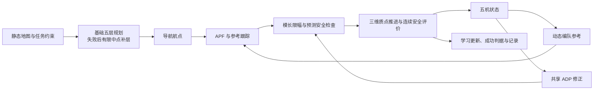

# 无人机编队智能避障仿真软件 2.3.3

五架无人机在 **80×80×30 m** 的三维静态环境中飞行。规划使用有限高度层，控制由 APF、编队参考跟踪、共享 Actor–Critic ADP 和预测安全修正组成。当前重点是可解释性、实时性、鲁棒性与轻量性。

## 当前状态 · 2026-10-09

| 项目 | 当前结果或配置 |
|---|---|
| 软件版本 | **2.3.3**，权威配置为 `config/default_params3d.m` |
| 正常随机场景完整任务 | **1955/2000 = 97.75%**；seed 10001–12000；95% Wilson 区间 97.00%–98.31% |
| 失败 | 34 次安全修正未解决、10 次任务超时、1 次重规划失败 |
| 规划 / 参考余量 | **1.2 / 4.0 m**；各向同性；硬障碍 / 机间阈值为 0.6 / 1.0 m |
| 高度选择 | 基础 **5、10、15、20、25 m**；规划失败后补可用区间中点，最多新增 8 层 |
| 速度 / 命令加速度上限 | 3 m/s / 3 m/s²，按三维向量模长限幅 |
| 仿真步长 / 任务上限 | 0.05 s / 120 s |
| 共享 ADP 参数 | Critic 6 个、Actor 3×6 个，共 **24 个标量** |
| 已记录单步耗时 | 平均 11.67 ms，P95 26.36 ms，P99 40.08 ms；**5478/1423679 步超过 50 ms（0.3848%）** |
| 实时性状态 | 计时来自六个并行 MATLAB 进程；最大单步 12.55 s；**单进程复测尚未开展** |

正常随机地图通过初始编队、首尾连续航段、终端队形及独立运动见证条件筛选，保留全部候选与拒绝原因。97.75% 只适用于该条件分布和无噪声质点模型；不直接与旧无约束或结构化地图的成功率比较。初始规划不计入上述单步分母，飞行中重规划和终端规划计入。

**组员先读：**[当前状态](docs/CURRENT_STATUS.md) · [协作与复现指南](docs/TEAM_GUIDE.md) · [最新交接](docs/HANDOFF_CURRENT_20261009.md)

## 快速运行

需要 Windows 与 MATLAB R2024a。克隆本私有仓库后，在 MATLAB 中进入项目根目录：

```matlab
r = main;                          % 默认 S8_window，保存 MAT 和三维诊断图
```

运行正常随机场景并导出动画：

```matlab
cleanup = setup_project();
p = default_params3d();
p.sceneId = 'random_normal';
p.seed = 10001;
p.animate = true;
r = main3d(p);
```

`main`、`main3d` 与 `Start_UAV.cmd` 使用当前三维配置。输出目录为项目内 `results/3d_run_v2.3.3_时间戳/`，包含仿真 MAT、`cycle_ms.csv`、PNG/FIG 及启用动画时的 `flight_3d.mp4`。正常地图还保存生成候选 MAT、CSV 和 JSON 收据。本机项目根目录位于 F 盘，运行与临时文件继续保存在 F 盘。

对已有轨迹导出视频：

```matlab
cleanup = setup_project();
render_3d_animation(fullfile('results','某次运行','simulation_result.mat'), ...
    fullfile('results','某次运行','flight_3d.mp4'));
```

MAT 格式支持 `main3d` 的 `result` 与实验运行器的 `r`。当前默认 `animate=false`。

## 随机场景入口

| 场景 ID | 规则与用途 |
|---|---|
| `random` / `random_normal` / `normal_random` | 当前 2.3.3 正常场景，最多 100 张完整候选；保存拒绝记录 |
| `random_unconditioned` | 原无约束随机体，数量、类型、尺寸和中心随机，允许重叠；可能出现无效初始位置 |
| `random_structured` | 历史四类结构化分布：混合体、顶棚、单窗口、交错窗口 |
| `random_legacy` | 2.0.0 的旧几何分布；精确复现还需对应冻结源码 |

所有障碍均为已知静态球体、有限圆柱或轴对齐箱体，支持悬空、顶棚和高度窗口。正常图要求初始五机净空至少 2 m、首尾 5 m 航段净空至少 1.2 m、目标固定朝向 V 形净空至少 4 m、边界至少 1.2 m；独立固定朝向编队平移见证检查净空、速度、加速度与 120 s 时限。[详细生成规则](experiments3d/README_NORMAL_SCENES.md)

## 算法与职责



规划回答“路线经过哪里”；参考生成回答“每架机跟踪哪里”；APF 与跟踪控制生成基础加速度；ADP 依据六维特征在线修正；安全层检查下一步运动并在预算内修正。安全修正失败时终止任务并保留原因。[函数接口与实现说明](docs/three_dimensional/IMPLEMENTATION.md)

完整任务成功要求：长机目标误差≤1 m，僚机对动态参考的最大误差≤1 m，全部速度≤0.25 m/s，连续保持 1 s，且无硬失败。成功不等于全程维持刚性 V 形。

## 最新证据

- [正常场景 2000 seed 报告与完整 CSV](docs/three_dimensional/normal_random_2000_20261009/README.md)：全部预定任务、拒绝候选、冻结哈希和原始 MAT 审核。
- [单步耗时统计](docs/three_dimensional/step_timing_20261009/README.md)：逐 seed 汇总、全部 5478 条超时步骤、统计方法及核对记录。
- [正常场景功能验收](docs/three_dimensional/normal_scene_constraints_20261009/README.md)：12 图几何验证、四个三维回归套件及三次端到端冒烟。
- [结果与复现索引](docs/three_dimensional/RESULT_INDEX.md)：各阶段证据、图表与历史视频。
- [本次更新记录](CHANGELOG.md)。

仓库包含当前源码、运行器、紧凑 CSV/JSON、历史科研图与示例 MP4。完整逐步 MAT 和全部候选几何保存在本机 F 盘 `results/`，该目录不进入 Git；组员复测方法及数据边界见[协作指南](docs/TEAM_GUIDE.md)。

## 检查与复现

```matlab
cleanup = setup_project();
test_3d;
test_environment3d;
test_adaptive_height3d;
test_directional_clearance3d;
```

正常随机实验按照 `prepare → generate → flight → audit → analyze` 冻结地图，再运行完整任务。[2000 seed 运行器说明](experiments3d/README_NORMAL_SEED_STUDY.md)。不要把生成接受率当作飞行成功率，参数对照复用冻结地图，单进程计时复测尚未执行。

## 历史实验

| 版本 / 场景分布 | 已完成结果 | 入口 |
|---|---|---|
| 2.3.2 默认余量更新 | 1.2/4.0 m；S8 与回归验证通过 | [记录](docs/three_dimensional/default_margin_update_20261009/README.md) |
| 2.3.1，无约束 200 图、49 组合 | 9800 次任务；最高 121/200（60.5%），基线 80/200（40%） | [扫描报告](docs/three_dimensional/margin_grid49_20261008/REPORT.md) |
| 2.3.1，原结构化 1000 图同图回放 | 固定五层 564/1000，补层 1000/1000 | [回放报告](docs/three_dimensional/midpoint_study_20261008/REPORT.md) |
| 2.2.0，分方向余量独立验证 | 候选 1000/1000；属于另一参数与地图协议 | [边界报告](docs/three_dimensional/clearance_study_20261006/REPORT.md) |
| 2.0.0 三维基础阶段 | 489 次消融与扰动试验 | [历史技术报告](docs/three_dimensional/TECHNICAL_REPORT.md) |
| 1.1.1 二维 | 25000 次主扫描与 200 次补测 | [历史二维说明](docs/archive/README_v1.1.1_2d.md) |

历史报告、源码快照和数据保持各自版本信息。当前有限层搜索与五轮安全修正没有任意环境完备性或形式安全保证；仿真没有六自由度、动态障碍、通信延迟和实际电池功率模型。累计爬升、路长及加速度平方积分均为代理指标。
