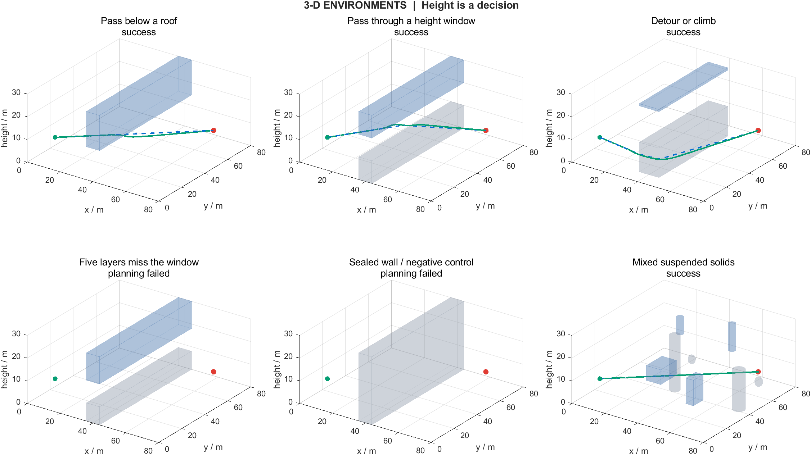
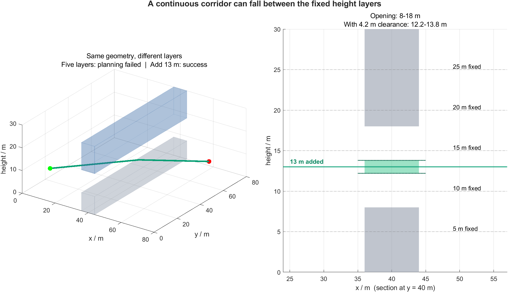

# 三维障碍与高度选择验证 · 2.1.0

2026-10-05 · 五架无人机 · 有限高度层 · F 盘原项目

## 这次解决了什么

旧 2.0.0 的随机圆柱高度不超过 20 m，五层最高是 **25 m**；地图也有球体，并非所有障碍都从地面生长。更直接的旧地图限制是：中心只在 15–65 m，半径不超过 4 m，边缘可绕行，因此旧 1150/1150 不能检验高度选择的困难。

当前场景加入**悬空圆柱、长方体、顶棚和带窗口墙体**。在有界规划区中，部分顶棚/墙体贯穿 y=0–80 m，不能通过侧边或最高层轻松绕过。这些是桥下、设施横梁、受限空域通道等的静态几何近似；边界也是任务约束，不能飞出 80×80 m 区域绕行。



## 代码怎样处理新障碍

1. `obstacle3d` 统一创建球体、闭合有限圆柱和轴对齐长方体；圆柱的底面可高于地面。
2. `obstacle_distance3d` 返回表面距离和朝外方向。长方体的面、棱、角均参与计算；体内距离为负。
3. `plan_layers3d` 用同一几何公式阻塞图节点，近障边、接入段与简化线段继续做连续检查。
4. APF、安全层和真实轨迹检查共用几何距离；僚机参考对箱体做保持高度的水平投影。
5. 静态图和视频使用 `draw_obstacles3d`，包含圆柱上下端盖。顶视图展示所有高度的投影，投影重叠不等于碰撞。

| 参数 | 当前规则 |
| --- | --- |
| 工作空间 | x/y=0–80 m，z=0–30 m |
| 默认高度层 | 5、10、15、20、25 m |
| 栅格、五层容量 | 1 m；32,805 节点 |
| 层内/层间连接 | 水平八邻接；相同 x/y 的相邻层竖直连接 |
| 速度、命令加速度模长上限 | 3 m/s、3 m/s² |
| 仿真步长、任务时限 | 0.05 s、120 s |
| 长机规划净空/硬安全距 | 4.2 m / 0.6 m |
| 机间硬安全距 | 1 m |
| ADP 可学习参数 | 全队共享 24 个标量 |
| 升降代价权重 | `verticalCostWeight=1`；可设 0 做纯路长对照 |
| 默认演示 | `S8_window`，顶部底部封闭，中间窗口可过 |

## 有路，为什么五层仍然失败

S10 的通道在 8–18 m。扣除两侧各 4.2 m 规划净空后，可用高度仅为 **12.2–13.8 m**。五个固定高度都不在里面；图规划失败。保持障碍、控制器、净空和限幅相同，仅手动加入 13 m 的独立对照，规划并飞行成功。这证明此例是高度采样漏路。

S11 则是贯穿整个受限横截面的实心墙，连续空间也无路；不把它与漏层情况混为一谈。



| 固定场景/对照 | 结局 | 任务时间 s | 实际长机路长 m | 累计爬升 m |
| --- | --- | ---: | ---: | ---: |
| S7 顶棚下穿 | success | 30.20 | 79.93 | 1.35 |
| S8 中间高度窗口 | success | 30.60 | 80.98 | 5.41 |
| S9 水平绕行/爬升选择 | success | 39.70 | 101.60 | 0.00 |
| S10 五层漏掉通道 | planning_failed | 0.00 | — | — |
| S11 连续空间封闭无路 | planning_failed | 0.00 | — | — |
| S10 独立补入 13 m 对照 | success | 30.40 | 80.41 | 3.29 |

## 新随机地图：预定 16 个 seed，全部保留

seed 1–16 在运行前写入协议，按模四依次进入混合体、顶棚、单窗口、交错窗口四类。默认每图共 8 个障碍，最多 300 次/体放置尝试。新增体水平中心采样覆盖 5–75 m；为起终各机名义位置预留 4 m 净空、长机端点保留 5.6 m，并用包围盒执行 1 m 保守间隔。**不以路径存在或飞行成功筛选地图。**

观察结果：**9/16 完成任务（本组 56.25%），7 个规划失败**。没有生成失败、执行异常、碰撞或超时。失败 seed：4, 7, 8, 11, 12, 15, 16。

| 地图族 | 样本 | 成功 | 规划失败 |
| --- | ---: | ---: | ---: |
| 自由混合三维体 | 4 | 4 | 0 |
| 交错高度窗口 | 4 | 0 | 4 |
| 全宽顶棚 | 4 | 4 | 0 |
| 全宽单窗口 | 4 | 1 | 3 |

这是刻意包含受限高度通道的、分层安排的小样本挑战验证，不代表任意真实环境的成功率。它与旧分布不同，不能用 56.25% 与旧 100% 直接比较算法优劣；也不合并旧 A/B/C、扰动或历史 seed 分母。

## 失败地图的独立补层诊断

对上述 7 张规划失败地图，从结构窗口的上下边界求中线候选高度，另外补入原五层，保持障碍与控制配置相同。所有原始结果继续保留在 `trials/`；诊断另存 `gap_diagnostics/`。新增候选并非默认规划器的自动流程，尚未实现一般障碍下的层选择预算或自适应策略。

补层后 **7/7** 张得到逐段满足 4.2 m 净空的连续路径证据，**7/7** 张完成实际编队飞行。只有获得该证据的地图，才能把原五层失败归因于离散采样不足。这是知道结构窗口边界后的事后诊断，不能写成已完成的自适应算法成功率。

| 原失败 seed | 补入高度 m | 总层数 | 路径证据最小净空 m | 飞行结局 |
| --- | --- | ---: | ---: | --- |
| 4 | 15.377858;18.7362387 | 7 | 4.220 | success |
| 7 | 11.6104663 | 6 | 4.445 | success |
| 8 | 17.9874352;18.7483253 | 7 | 4.239 | success |
| 11 | 12.4421575 | 6 | 4.226 | success |
| 12 | 12.2333027;16.9203976 | 7 | 4.241 | success |
| 15 | 17.7905416 | 6 | 4.303 | success |
| 16 | 12.7863286;15.1853067 | 7 | 4.227 | success |

## 少爬升，并不自动等于省电

规划代价为：**三维路长 + 权重 × 累计升降高度**。它是可解释的几何代理；默认权重 1 也没有通过真实电池数据标定。下面是同一 S9 地图、同一控制器、同一五层的对照：

| 升降权重 | 实际长机路长 m | 长机累计爬升 m | 全队累计爬升 m | 任务时间 s |
| ---: | ---: | ---: | ---: | ---: |
| 0 | 82.71 | 9.91 | 49.59 | 31.15 |
| 1 | 101.60 | 0.00 | 0.00 | 39.70 |
| 2 | 101.60 | 0.00 | 0.00 | 39.70 |

提高权重使该图从爬升改为水平绕行，但也延长了任务时间。新增指标分别记录长机/全队累计爬升、下降、路长，以及命令加速度平方积分（m²/s³）；这些都不能直接写成 J 或 Wh。实际能耗研究还需悬停、平飞、升降功率和推进效率，综合比较时间与高度变化。

## 四个项目重点现在怎样落实

| 重点 | 本轮落实 | 证据边界 |
| --- | --- | --- |
| 可解释性 | 窗口边界、有效高度区间、路长/升降权重、失败类型 | 没有宣称高度选择已经最优 |
| 实时性 | 五层图与静态缓存；诊断用 6–7 层，容量 39,366–45,927 | 逐周期日志仍保留；本轮不是硬实时认证 |
| 鲁棒性 | 加入顶棚、封边和漏层反例；成功与失败均记录 | 新场景尚未做大量 seed、噪声和扰动扫描 |
| 轻量性 | 解析几何体、有限层、24 个共享学习参数 | 没有完整体素网格或真实旋翼能耗模型 |

本机完成主试验的逐项墙钟耗时合计约 **98.1 s**，不含 MATLAB 启动、测试、诊断及视频绘制。本轮本地算力足够，**不需要租算力**。规划节点容量是规模说明，不能直接当成运行速度提升比例。

## 文件与复现

原始结果目录：`F:\UAV project\UAV_APF_ADP_Formation\results\environment3d_v2.1.0_20261005_105905_900`。

- `protocol.mat/json`：24 项任务、地图规则、层高、权重、配置与分母口径。
- `trials.csv`、`trials/*.mat`：全部 24 项原始结果，其中随机 seed 16 个；没有失败过滤。
- `source_snapshot/`、`source_sha256.csv`：30 个冻结源码，已逐项 SHA-256 校验。
- `trials_sha256.csv`：全部 24 个原始 MAT 的 SHA-256。
- `gap_diagnostics/`：独立补层路径证据、配置、结果与 CSV。
- `cases/`：顶棚、窗口、权重对照和 13 m 补层飞行 PNG / 可编辑 FIG。
- `S8_window_formation.mp4`：实际五机窗口穿越动画。
- `postprocess_source/`：本报告分析、绘图与诊断脚本。

在项目根目录运行（会生成新的结果目录）：

```matlab
cleanup = setup_project();
test_environment3d;
test_3d;
run_all_tests;
addpath('experiments3d');
s = run_environment_validation3d(1,16);
diagnose_environment_gaps3d(s);
plot_environment_validation3d(s);
```

数值模型仍为全知静态地图下的二阶质点：没有六自由度姿态、动态障碍、通信延迟或电池功率模型。旧技术报告和代码介绍书记录 2.0.0 阶段，不作为当前地图的新实验结论。
