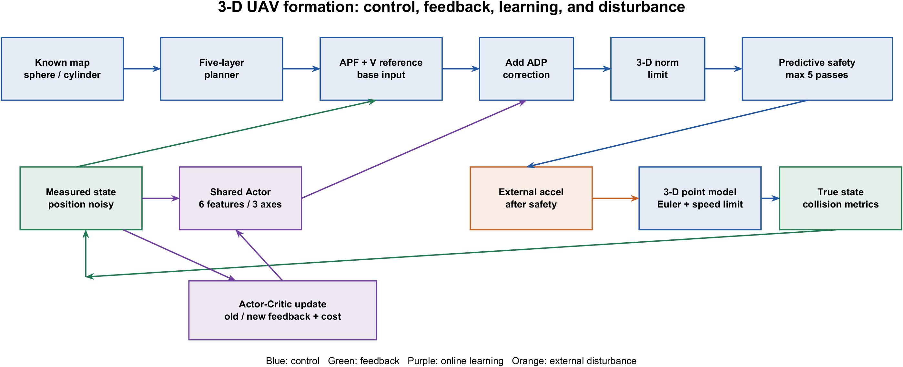
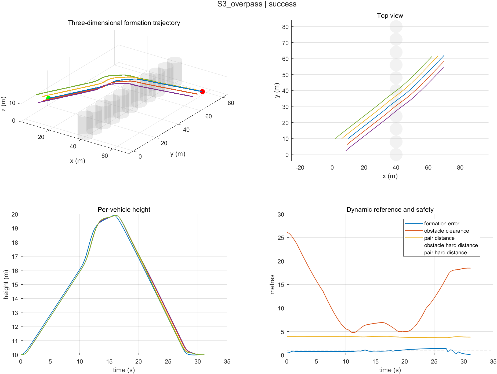
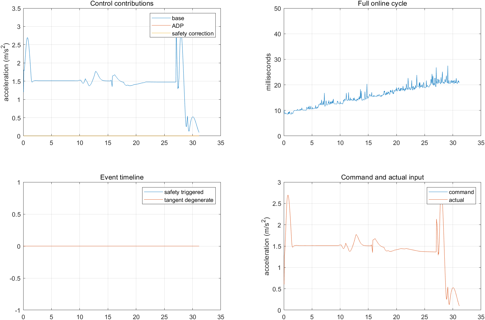
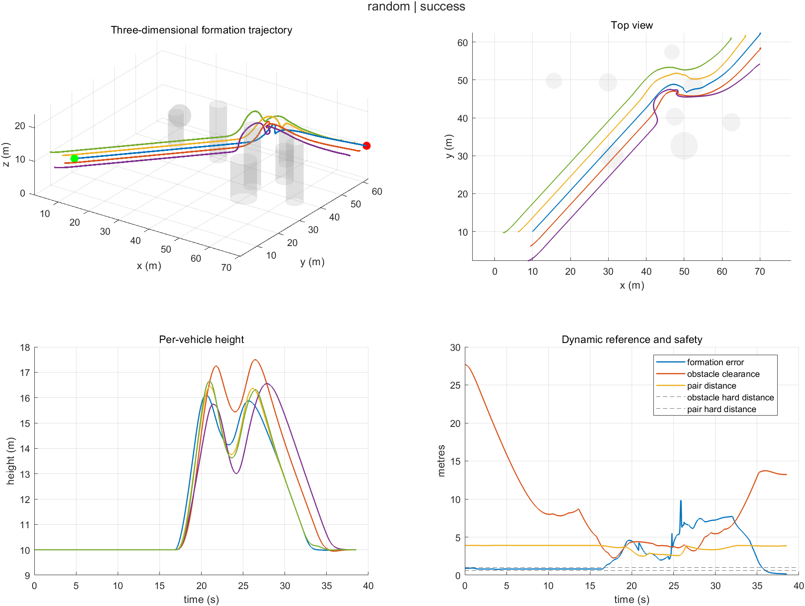
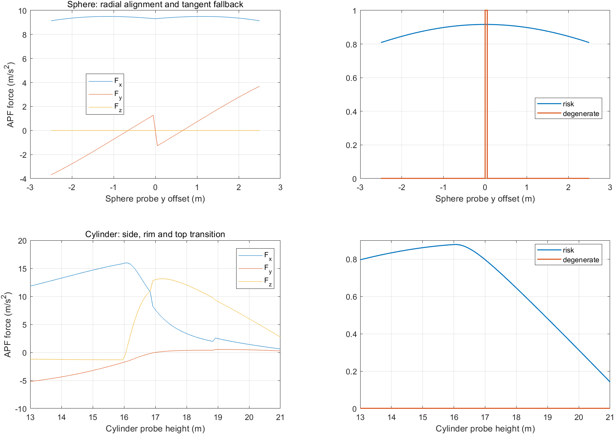

# 无人机编队智能避障三维有限高度层阶段技术报告

**版本与日期：**2.0.0，2026-10-03。**实现平台：**MATLAB R2024a，Windows，Intel Core i7-13700H（20 逻辑处理器），15.7 GB 内存。**实验源码与数据：**见第 6 节索引。本文根据《无人机编队智能避障项目技术报告修改意见与阶段任务书》落实三维程序和实测补证。任务书中引用的《三维扩展修订版(1).pdf》未随本项目提供，因此本文是独立三维阶段报告，不声称逐页修改了那份修订版。原 2026-09-24 二维报告和数据保留为历史基线。

## 摘要

项目将五机领航跟随仿真从二维静态圆障碍扩展到 0–80 m × 0–80 m × 0–30 m 的三维空间。五个规划高度层为 5、10、15、20、25 m；三维二阶质点、球体和有限高度圆柱、水平 V 形参考整体升降、全局路径规划、APF、共享 Actor–Critic ADP 与预测安全修正均已落地。有限层图最多 32,805 个节点，为 81³ 完整体素节点数的约 6.17%，但该比例不代表实际耗时或内存同比下降。完整实验预定 489 个任务，含六个固定场景、150 张预先固定的随机地图、A/B/C 消融及两类单因素扰动。**全量结果、计时和局限见第 4–5 节，所有数字均来自冻结运行日志。**

## 1 模型、控制链与参数

### 1.1 三维动力学与尺度

第 i 架无人机的状态为三维位置 p_i 和速度 v_i。每个 0.05 s 周期先将候选命令 u_i 按向量模长限到 3 m/s²，预测安全层在该限制下修正，再于实际推进时加入外部加速度 d_i；速度更新为 v_next = clip(v + Δt(u + d), 3 m/s)，位置更新为 p_next = p + Δt v_next。所有无人机同步更新；位置越界、障碍扫掠相交或同一时段机间相交由真实状态独立判定。扰动试验中实际 u+d 可能超过命令上限，不能把二者混称。

| 参数 | 历史二维 1.1.1 | 当前三维 2.0.0 |
| --- | --- | --- |
| 空间与状态 | 80×80 m；每机 x、y、vx、vy | 80×80×30 m；每机 x、y、z、vx、vy、vz |
| 起点与目标 | (10,10) → (70,62) m | (10,10,10) → (70,62,10) m |
| 时间设置 | Δt=0.05 s，Tmax=500 s | Δt=0.05 s，Tmax=120 s |
| 限制 | 速度模长 3 m/s；命令加速度模长 3 m/s² | 相同数值，作用于三维模长 |
| 规划 | 1 m 二维八邻接栅格 | 五个高度层；层内八邻接、相邻层同 x/y 垂直连接 |
| 障碍 | 静态圆 | 静态球体与有限高度垂直圆柱 |
| 长机规划/障碍硬安全距 | 4.2/0.6 m | 4.2/0.6 m；在线起点接入用 0.75 m |
| 编队参考 | 二维水平历史滞后 V 形 | 水平投影弧长滞后、横向 V 形、同步高度 |

### 1.2 可解释的模块顺序

全局规划输出长机航点；APF 与编队控制并列形成基础加速度；共享 Actor 依据六个特征提供三轴小幅修正；合成输入经三维模长限幅、最多五轮预测安全修正，再进入动力学。反馈位置可加入噪声，速度在本轮试验保持真值；外部加速度只在安全层之后注入。Critic 和 Actor 在周期末依据前后状态更新。安全层仅处理本步硬约束，不代替全局路径规划。函数接口和更新频率逐项列在 `IMPLEMENTATION.md`。

六个 ADP 特征依次是障碍风险、目标距离、速度、队形误差、航向偏差和常数项。共享 Actor 为 3×6，Critic 为 6×1，全队只有 24 个可学习标量；旧二维为 18 个。每张地图每组从零初始化，固定增益、五机状态与日志不计入参数数。ADP 修正最终模长上限为 0.4 m/s²。若消融没有显示稳定收益，不能仅凭模块存在就宣称 ADP 有效。

## 2 有限高度层、几何与参考

### 2.1 分层图与连续检查

高度层 5、10、15、20、25 m 各有 81×81 个水平节点。层内八邻接的代价为 1 或 √2 m；层间仅同 x/y 相邻高度连接，代价为层间实际高度差，不设水平加垂直的斜连。建图先排除障碍表面净空小于 4.2 m 的节点，再核对候选边的连续线段、起终连接和视线简化后的整段。在线重规划起点可能位于 4.2 m 图膨胀区，起点接入改用 0.75 m，图内与目标段仍要求 4.2 m；静态图缓存复用。终端僚机局部图净空为 1.9 m。若搜索失败，只能说明该离散图和连接规则下没有找到路线。

| 方案 | 理论节点容量 | 与完整 81³ 节点比 | 解释 |
| --- | ---: | ---: | --- |
| 历史二维栅格 | 6,561 | 1.23% | 不包含高度可行性 |
| 当前五层图 | 32,805 | 6.17% | 实际可用节点随障碍而变 |
| 1 m 完整体素算术对照 | 531,441 | 100% | 仅作容量对照，项目未实现或计时 |

球体使用三维表面有符号距离；有限圆柱同时考虑侧壁、顶底面和圆形棱边。球体扫掠有解析最小距离；圆柱以距离下界先排除远离障碍的线段，对近距离线段做有界一维极小化。机间碰撞按同一时间段的相对运动线段检测，因此垂直穿障和两机交叉不会因端点安全而被忽略。这是数值检查，不是形式化安全证明。

### 2.2 编队参考和 APF 退化

四架僚机沿长机**水平投影弧长**查滞后点，按水平航向的法向叠加 V 形横向偏移，参考高度与长机当前高度同步。长机低水平速度时沿用最近有效航向；终端用 2 s 混合到固定航向 V 形，并允许障碍使参考点偏移。队形 RMS 是每个时刻四架僚机对各自动态参考的最大误差的时间均方根，不能解释为全程刚性 V 形误差。噪声试验的历史弧长按保持真值的水平速度积分，避免位置抖动积成虚假路程。

三维 APF 切向量取航点方向在局部障碍法平面内的投影；投影模长小于 10⁻⁶ 时尝试目标方向，仍退化则减速并交由停滞重规划。固定球体、圆柱顶面与扫掠测试及 `S3_overpass` 的整队越顶轨迹用于检查几何与升降连续性。

## 3 预定试验与指标口径

固定场景 S1 单球、S2 有限圆柱、S3 上绕墙、S4 空间 S 形、S5 多路径选择、S6 终端归队，加上随机种子 1–150 的 150 张三维地图，在运行前写入 `protocol.mat` 和 `frozen_maps.mat`。随机图每张尝试放置 8 个球体或有限圆柱，不能与历史二维 25,000 次筛选生成器混为一谈。每图 A 为 APF+编队，B 在 A 上开启 ADP，C 在 B 上开启预测安全修正；共同保留全局规划、命令限幅、基础机间作用和独立真实状态碰撞判定。地图、初态、起终点、共同参数和评价规则逐图复用。468 次消融加 21 次扰动，总计 489 个计划任务，不按算法结局删图。

位置噪声每轴独立高斯，每周期重新抽样，标准差为 0、0.02、0.05、0.10 m；标准差没有硬上界。外部加速度每周期重新抽取三维方向和 0 到 D 的均匀幅值，D 为 0.05、0.10、0.20 m/s²，两类扰动分开测试。每个等级在 S1、S3、S6 的 C 组上运行，与相同地图零扰动基线比较。扰动序列、真实状态和逐周期命令均保存在各试验 MAT 中。

成功要求长机到目标、编队误差、速度分别达到 1 m、1 m、0.25 m/s 的条件并保持 1 s；其它结局单独记录。完成时间、路径和队形 RMS 的组均值只使用成功任务；最小飞行净空和机间距离覆盖所有已执行飞行任务。路径系数为长机实际路径长度除以三维起终直线距离 √(60²+52²)≈79.40 m。三维高度跨度取长机全程最大 z 减最小 z，并另存累计垂向位移。随机图的二项置信区间采用 Wilson 95% 公式；相同地图上的时间、路径和 RMS 差值另给出共同成功图的配对均值及种子固定的 4,000 次自助法区间。重复零噪声运行不算独立随机地图。

## 4 实测结果

### 4.1 全量结局与消融

全量 CSV 有 **489/489** 个唯一任务和同数 MAT，结局均为 `success`，错误文件为 0；其中消融为每组 6 个固定图加 150 个随机图。以下时间、路径和 RMS 是各组 156 个成功任务的算术均值，最后一列是全程已执行飞行的最小值，不是障碍之间的间距。

| 组别 | 成功数 | 时间/s | 路径/m（系数） | 队形 RMS/m | 净空/机间距 m |
| --- | ---: | ---: | ---: | ---: | ---: |
| A 基础 | 156/156 | 33.328 | 84.216（1.06068） | 3.5429 | 1.815/2.502 |
| B +ADP | 156/156 | 33.322 | 84.212（1.06064） | 3.5418 | 1.818/2.503 |
| C +安全层 | 156/156 | 33.322 | 84.212（1.06064） | 3.5418 | 1.818/2.503 |

三组在各自的 150 张随机图上都是 150/150 成功；单组 Wilson 95% 区间约为 **97.50%–100%**，不表示真实失败概率为零。所有 156 张图都为 A/B/C 共同成功图。逐图 B−A 的平均差值：完成时间 −0.00545 s（4,000 次描述性自助法 95% 区间 −0.01635 至 +0.00064 s），路径 −0.00362 m（−0.00509 至 −0.00230 m），队形 RMS −0.00107 m（−0.00175 至 −0.00013 m）。路径与 RMS 的差值方向一致，但绝对量级仅为毫米，尚无工程上可辨的任务收益。C−B 的时间、路径和 RMS 逐图完全相同，安全层触发次数为 **0**；这些地图没有提供安全修正收益的实证。

### 4.2 完整周期、规划事件与二维对照

每步 `cycleMs` 从参考和控制计算开始，涵盖 ADP 更新、安全判定及该步发生的事件规划，截止该步日志写入；初始建图、预生成扰动、场景生成、绘图和磁盘写入另计或不计。全量运行未显式预热，首批 JIT/缓存效应保留。二维/三维对照脚本在同一 MATLAB 进程内做短预热，其场景集合不同，不能把两者的相对耗时解释为纯维度因果效应。

完整 489 组记录了 **325,774 个在线周期**，其中 **34 个超过 50 ms**（0.0104%，分布在 10 个试验）；最大单周期为 **106.77 ms**。各试验自身 P99 的最大值为 **65.70 ms**，来自 S3 的 0.02 m 位置噪声试验；不能说全量 P99 均低于预算。A/B/C 组每试验周期均值再等权平均分别为 **4.365/5.897/6.538 ms**。同地图配对 B−A 增加 1.531 ms，C−B 再增加 0.642 ms；后者没有带来可观测轨迹变化。这里的组均值不按每图周期数加权。

初始规划时间中位数 **1.697 s**、最大 **3.276 s**，不计入周期计时。全量发生 **3 次在线重规划**，单次最大 **10.05 ms**；终端四架僚机共发生 **1,956 次局部规划调用**，单次最大 **4.12 ms**，这些事件若发生在控制周期内则同时计入该周期总耗时。S3 图的五层规划容量为 32,805 节点，实际可用 21,918 节点、边 101,775 条。

全量运行中，我在 `noise_S3_overpass_020` 附近启动过同机 CSV 后处理，可能干扰了该试验的耗时；原始 65.70 ms P99、106.77 ms 最大值和超期周期均原样保留。随后预热并单独重跑 S3 的四个噪声等级，P99 依次为 **22.97/23.49/22.09/25.15 ms**，四组没有超 50 ms 周期，原始日志存于 `results/s3_timing_recheck_v2.0.0_20261003_231219_746/`。该复测说明耗时受运行环境影响，但不能反证原始超期记录；正式结论以两套数据并列陈述。

| 单次预热对照场景 | 结局 | 周期 P99/ms | 最大/ms | 超 50 ms 周期 |
| --- | --- | ---: | ---: | ---: |
| 二维空图 | 成功 | 1.78 | 9.04 | 0/604 |
| 三维空图 | 成功 | 2.77 | 24.37 | 0/603 |
| 二维默认 16 圆障 | 成功 | 3.93 | 36.04 | 0/716 |
| 三维单球 | 成功 | 3.17 | 37.21 | 0/649 |
| 三维有限柱墙上绕 | 成功 | 23.54 | 34.11 | 0/623 |

该对照的源文件与 `summary.csv` 存在 `results/dimension_benchmark_v2.0.0_20261003_215512_652/`。空图条件相近但动力学及实现仍不同；其余场景的障碍个数和分布不同。50 ms 是本实验仿真步长的计算预算，P99 小于预算不代表全部周期满足预算，更不构成飞控硬实时证明。

### 4.3 噪声、外部加速度与几何案例

预定的 21 个单因素扰动任务均成功，且没有预测安全层修正触发。按同地图 C 组，位置噪声各等级的全过程队形 RMS 如下；每个单元只是一条固定随机序列，不是独立重复均值。

| 场景 | σ=0 m | σ=0.02 m | σ=0.05 m | σ=0.10 m |
| --- | ---: | ---: | ---: | ---: |
| S1 单球 | 2.737 | 2.847 | 3.297 | 3.305 |
| S3 上绕墙 | 0.916 | 1.176 | 1.943 | 2.134 |
| S6 终端 | 2.887 | 2.955 | 3.370 | 3.495 |

外部加速度上限 D 的相同指标如下。D=0 行为同地图零扰动基线；位置噪声与外部加速度未联合施加。

| 场景 | D=0 | D=0.05 | D=0.10 | D=0.20 m/s² |
| --- | ---: | ---: | ---: | ---: |
| S1 单球 | 2.737 | 2.740 | 2.744 | 2.751 |
| S3 上绕墙 | 0.916 | 0.916 | 0.916 | 0.920 |
| S6 终端 | 2.887 | 2.892 | 2.894 | 2.906 |

所测范围内，**位置噪声比给定外部加速度更明显地损害队形跟踪**。例如 S3 在 σ=0.10 m 时，时间从 31.15 增至 32.10 s，路径系数从 1.0417 增至 1.0454；最小障碍净空为 4.762 m、最小机间距为 3.832 m，仍高于各自硬阈值。S1 和 S6 在同一噪声等级的 RMS 分别比基线上升约 21%。D=0.20 m/s² 下 S3 的 RMS 为 0.920 m，路径系数 1.0418，最小障碍净空 4.779 m。逐图时间、路径、净空、机间距离和结局详见 `trials.csv` 与 `analysis_summary.json`；本试验没有找到碰撞或失效等级，也未证明未测更强扰动下的安全性。

S3 场景的圆柱墙迫使长机从上方越过，五层图路线到 20 m，实际高度跨度 **9.924 m**、累计垂向位移 **19.847 m**、最小障碍净空 **4.790 m**；五机升降曲线见图 2。随机图 seed 18 曾在修复前因重规划实际起点落入 4.2 m 图膨胀区而失败；起点接入采用 0.75 m 并复用图后，同图 A/B/C 均于 38.55 s 成功，C 组重规划用时 **6.73 ms**、最小障碍净空 **2.267 m**。这是针对已发现缺陷的回归证据，不能充当独立的算法优势样本。对应前后记录见 `ISSUE_LOG.md`。

图 5 的 202 个几何取样中力分量均有限，球体径向共线处触发一次退化标志。不过近共线位置的切向分量和圆柱侧壁至顶缘过渡处存在明显方向变化；这是**独立几何探针**而非真实飞行振荡证据。当前限幅和停滞重规划保证所测场景数值可执行，尚未证明靠近棱边时控制连续或无上下抖动，后续应针对该位置做更密的动态压力试验。

## 5 四项重点与证据边界

**可解释性。**控制流程逐模块可指向函数和输入输出；六个特征、24 个共享权重、基础/ADP/安全输入均可追溯。A/B/C 的配对结果用于判断增量，若安全层没有触发，仅能说在这些地图上未观测到安全修正收益。图 2 和诊断图是全过程案例，不能由单例外推普遍有效。

**实时性。**将在线周期尾部、最大值和超 50 ms 比例与初始规划、重规划、终端局部规划分开列示。在线事件规划确实阻塞时仍计入周期总耗时。所有计时限定于所测 Windows/MATLAB/CPU、未固定操作系统调度，尚未证明严格实时。

**鲁棒性。**随机地图成功率只描述该生成规则下的适应性；位置噪声与输入扰动的单因素结果描述指定幅度内的表现，不能外推风场、通信延迟、动态障碍或最坏界。已知反馈速度保持真值，且扰动后没有再次把总加速度限到 3 m/s²。

**轻量性。**五层容量为 32,805，ADP 权重为 24，安全修正最多五轮；没有引入六自由度、大网络、MPC、主动压缩或分流。实际计算负担由连续几何、图搜索、障碍数和重规划事件共同决定，节点比例不能替代实测。

<!-- PAGEBREAK -->

## 6 适用范围与复现索引

### 6.1 适用范围

局限包括已知静态地图、同步质点、有限高度层可能漏掉连续空间可行路径、启发式 APF/安全修正没有全局收敛或严格避碰证明。历史二维局部固定参考的 PD 线性分析不外推到完整三维闭环。原二维主扫描 25,000 个计划任务中 24,783 成功、209 生成失败、1 碰撞、7 超时；计划任务成功比例与条件飞行成功率分开，不与三维分母混用。

### 6.2 数据与可编辑源

| 内容 | 位置与可复核对象 |
| --- | --- |
| 三维模型、参数、控制链 | `config/default_params3d.m`、`src3d/`、`IMPLEMENTATION.md` |
| 几何与回归测试 | `src3d/plan_layers3d.m`、`tests/test_3d.m`、历史二维 `tests/run_all_tests.m` |
| 试验与统计 | `STUDY_PROTOCOL.md`、`experiments3d/run_study3d.m`、`experiments3d/analyze_study3d.py` |
| 冻结原始数据 | `results/3d_study_v2.0.0_20261003_221816_234/` 中的地图、协议、21 个源码 SHA-256、489 个 MAT 和 `trials.csv`；紧凑副本在 `docs/three_dimensional/data/` |
| 图 1–5 与报告 | `flow.mmd`、`draw_flow3d.m`、`assets/` 的 `.fig/.png`、本报告 `.md` 与 `build_report_pdf.py` |

逐项目录、补充耗时试验与探索性运行的边界见 `RESULT_INDEX.md`。图 2 来源于 `C_S3_overpass.mat`，图 3 与图 2 同一次试验，图 4 来源于 `C_random_018.mat`；各图的 MATLAB `.fig` 可继续编辑。图 5 是独立几何探针。

历史二维报告：`docs/导师报告_20260924/`；历史二维大规模数据包：`docs/障碍物扫描原始结果_20260923_20260924.zip`。教师任务书的逐项反馈和修改位置放在独立的 `TASK_FEEDBACK.md`，不将任务清单混入报告正文。
