# 分方向余量与系统边界实验报告

版本 2.2.0 · 数据目录 `clearance_boundary3d_v2.2.0_20261006_203154_442`

## 结论与使用条件

最终实验候选 `f005`：规划水平余量 **5.6 m**，参考水平余量 **4.4 m**，规划/参考共享竖直余量 **2 m**。仍用 5/10/15/20/25 m 固定层，障碍硬安全距 0.6 m、机间硬安全距 1 m。

独立 seed 1001–2000 中，基线 **581/1000（58.1%）**，候选 **1000/1000（100.0%）**；同图救回 419 张，丢失 0 张。此结论对应当前四族等量合成地图、质点模型及名义无噪声无外扰条件。边界组中的失败同样保留，不能把名义成功率作为真实飞行保证。

## 实验范围与可复现性

新执行 **8422 次任务**；原 2.1.0 的 1000 次记录另作冻结基线。先全域扫描 210 组参数（每组相同 8 图），再从三个分离区域细化，保留两个分离候选进行 1000 图确认和稳健性筛选。最终候选在独立验证运行前冻结。

| 阶段 | 任务数 |
| --- | --- |
| screen | 1688 |
| refine | 880 |
| nominal | 2000 |
| robust | 840 |
| holdout | 2000 |
| boundary | 480 |
| geometry | 270 |
| ablation | 240 |
| timing | 24 |

每个任务保留原始 MAT、参数、逐周期状态/参考/噪声/外扰、地图几何哈希、成功或失败原因。所有运行使用源码快照提交 `da6b2db6b6c6c3dcd339b8e8e9f99934c2d04b3d`。实际任务协议以各阶段 CSV/JSON 为准，数值源文件哈希以 `source_sha256.csv` 为准。

## 三个余量怎样影响系统

规划水平余量决定长机通路预留；参考水平余量决定跟机参考点离障碍的水平距离；共享竖直余量决定规划和参考的竖直障碍膨胀。障碍按水平/竖直半轴构成的椭球膨胀，实际碰撞仍按物理距离判定。降低竖直余量能扩大窗口可用高度区间，降低水平余量能增加水平通路；两者也会减小跟踪误差与扰动的容错空间。

`desiredClear` 同时被旧地图生成器读取，因此本实验直接冻结旧 MAT 的地图，将地图生成参数与待调控制参数分离。同 seed、同地图、同随机序列才形成有效对照。

## 参数选择过程

| 粗筛中心 | 规划水平/m | 参考水平/m | 竖直/m | 成功/8 |
| --- | --- | --- | --- | --- |
| c200 | 5.6 | 4.0 | 2.0 | 8/8 |
| c199 | 5.6 | 3.0 | 2.0 | 8/8 |
| c160 | 4.2 | 4.0 | 1.5 | 8/8 |

| 确认候选 | 规划水平/m | 参考水平/m | 竖直/m | 旧图成功/1000 | 稳健性组合成功/280 | 稳健性安全失败数 |
| --- | --- | --- | --- | --- | --- | --- |
| f005 | 5.6 | 4.4 | 2.0 | 1000/1000 | 280/280 | 0 |
| f012 | 5.6 | 3.4 | 2.0 | 1000/1000 | 280/280 | 0 |

三个粗筛区域按参数归一化距离保持分离，各轴细化；两个确认候选继续保持分离。最终排序以冻结的选择规则为准：先少碰撞/无效状态/执行错误，再稳健性、名义和最差场景成功率，最后较大竖直余量。完整分数和决策收据在 `selection.json`；若存在边界越界，也按安全失败披露。稳健性 280 次包含重复地图，只用于候选排序。旧图 1000 张中包含调参地图，因此独立结论以另外 1000 张为准。

## 并列候选的解释

本次两个候选的旧图确认和稳健性筛选均全部成功，最终分数完全平局。冻结执行器按配置编号固定排序取 f005 作为独立验证代表，同时保留 f012 对照。两者形成可用参数点的证据，后续可结合机型误差预算和编队形变指标选择；本次没有统计证据证明其中一个在所有场景都更优。

## 为什么不能只沿一个方向调参

| 增加的余量轴 | 相邻格点同图比较次数 | 增加后救回 | 增加后丢失 |
| --- | --- | --- | --- |
| pathXY | 1400 | 10 | 6 |
| refXY | 1344 | 8 | 1 |
| planZ | 1440 | 2 | 90 |

每次比较仅改变一个余量，其余参数和地图相同；比较的是完整飞行结局。同一张地图参与多次比较，这些计数用于显示非单调性，不作为独立成功率。改变规划余量可能改变离散路线，改变参考余量也改变跟机参考和安全修正，因此不能假设余量越小或越大，任务表现一定越好。逐案例对照见 `nonmonotonic_examples.csv`。

## 成功率与独立验证

| 数据 | 方案 | 成功/任务 | 成功率 | Wilson 95% 区间 |
| --- | --- | --- | --- | --- |
| 旧图确认 | f005 | 1000/1000 | 100.0% | 99.62%–100.00% |
| 独立验证 | baseline | 581/1000 | 58.1% | 55.02%–61.12% |
| 独立验证 | f005 | 1000/1000 | 100.0% | 99.62%–100.00% |

| 场景 | 基线 | 候选 |
| --- | --- | --- |
| mixed | 250/250 | 250/250 |
| staggered_windows | 18/250 | 250/250 |
| underpass | 250/250 | 250/250 |
| window | 63/250 | 250/250 |

同图成功率差：41.9 个百分点；配对正态近似 95% 区间 38.84–44.96 个百分点。Wilson 区间描述单方案比例，配对差另算，二者不可混用。验证集在生成时已冻结，但生成地图没有读取规划/飞行结局。

## 同图性能和安全距离

以下差值为候选减基线，仅使用独立验证两方案共同成功的 **581 张**地图。新增成功另列，避免不同成功样本混在一起导致假改善。

| 指标 | 配对数量 | 平均差值 | 中位差值 |
| --- | --- | --- | --- |
| time | 581 | -0.1238 | 0.0000 |
| path | 581 | -0.0874 | 0.0798 |
| verticalTravel | 581 | -0.4497 | 0.0000 |
| formationRms | 581 | -0.3177 | -0.1918 |
| minObstacleClearance | 581 | 0.2642 | 0.3257 |
| minPairDistance | 581 | 0.0447 | 0.0358 |
| commandEffort | 581 | -20.0759 | 0.0000 |

| 独立验证飞行指标 | 基线最小值 | 候选最小值 |
| --- | --- | --- |
| minObstacleClearance | 1.5395 | 1.4808 |
| minPairDistance | 2.6778 | 1.9742 |

升降、路长和平方命令加速度积分为代理指标，尚无机型质量、效率和电池功率模型，不能换算为真实节能百分比。`formationRms` 针对变形后的参考编队，不等同于相对原始 V 形的形状误差；降低参考余量也改变参考本身，需结合真实跟机高度偏差、物理间距和参考阻塞比例解读。

## 稳健性筛选

| 方案 | 位置噪声标准差/m | 外扰上界/m/s² | 成功/40 | 结果计数 |
| --- | --- | --- | --- | --- |
| baseline | 0.0 | 0.0 | 24/40 | {'success': 24, 'planning_failed': 16} |
| baseline | 0.0 | 0.1 | 24/40 | {'success': 24, 'planning_failed': 16} |
| baseline | 0.0 | 0.2 | 24/40 | {'success': 24, 'planning_failed': 16} |
| baseline | 0.02 | 0.0 | 24/40 | {'success': 24, 'planning_failed': 16} |
| baseline | 0.05 | 0.0 | 24/40 | {'success': 24, 'planning_failed': 16} |
| baseline | 0.05 | 0.2 | 24/40 | {'success': 24, 'planning_failed': 16} |
| baseline | 0.1 | 0.0 | 24/40 | {'success': 24, 'planning_failed': 16} |
| f005 | 0.0 | 0.0 | 40/40 | {'success': 40} |
| f005 | 0.0 | 0.1 | 40/40 | {'success': 40} |
| f005 | 0.0 | 0.2 | 40/40 | {'success': 40} |
| f005 | 0.02 | 0.0 | 40/40 | {'success': 40} |
| f005 | 0.05 | 0.0 | 40/40 | {'success': 40} |
| f005 | 0.05 | 0.2 | 40/40 | {'success': 40} |
| f005 | 0.1 | 0.0 | 40/40 | {'success': 40} |

外扰保持 20 周期，即每 1 s 换一次随机向量，各机方向独立、幅度在 0–上界之间均匀抽取。位置噪声为每周期、每坐标独立的高斯噪声；速度反馈无噪声。不同方案共用噪声/外扰序列。40 张地图跨多个条件重复，不将所有条件合并视作更多独立地图；筛选数据也不算独立验证。高斯噪声没有有限绝对上界，此结果对应所用随机扰动模型。

## 系统边界在哪里

| 方案 | 边界轴 | 强度 | 成功/任务 | 失败与成功计数 |
| --- | --- | --- | --- | --- |
| baseline | noiseStd | 0.0 | 8/16 | {'success': 8, 'planning_failed': 8} |
| baseline | noiseStd | 0.02 | 8/16 | {'success': 8, 'planning_failed': 8} |
| baseline | noiseStd | 0.05 | 8/16 | {'success': 8, 'planning_failed': 8} |
| baseline | noiseStd | 0.1 | 8/16 | {'success': 8, 'planning_failed': 8} |
| baseline | noiseStd | 0.2 | 8/16 | {'success': 8, 'planning_failed': 8} |
| baseline | noiseStd | 0.35 | 1/16 | {'timeout': 7, 'planning_failed': 8, 'success': 1} |
| baseline | noiseStd | 0.5 | 0/16 | {'timeout': 8, 'planning_failed': 8} |
| baseline | noiseStd | 1.0 | 0/16 | {'safety_unresolved': 8, 'planning_failed': 8} |
| baseline | noiseStd | 2.0 | 0/16 | {'safety_unresolved': 8, 'planning_failed': 8} |
| baseline | disturbanceMax | 0.0 | 8/16 | {'success': 8, 'planning_failed': 8} |
| baseline | disturbanceMax | 0.1 | 8/16 | {'success': 8, 'planning_failed': 8} |
| baseline | disturbanceMax | 0.2 | 8/16 | {'success': 8, 'planning_failed': 8} |
| baseline | disturbanceMax | 0.4 | 8/16 | {'success': 8, 'planning_failed': 8} |
| baseline | disturbanceMax | 0.8 | 8/16 | {'success': 8, 'planning_failed': 8} |
| baseline | disturbanceMax | 1.5 | 7/16 | {'success': 7, 'timeout': 1, 'planning_failed': 8} |
| baseline | disturbanceMax | 3.0 | 1/16 | {'timeout': 7, 'planning_failed': 8, 'success': 1} |
| f005 | noiseStd | 0.0 | 16/16 | {'success': 16} |
| f005 | noiseStd | 0.02 | 16/16 | {'success': 16} |
| f005 | noiseStd | 0.05 | 16/16 | {'success': 16} |
| f005 | noiseStd | 0.1 | 16/16 | {'success': 16} |
| f005 | noiseStd | 0.2 | 16/16 | {'success': 16} |
| f005 | noiseStd | 0.35 | 0/16 | {'timeout': 16} |
| f005 | noiseStd | 0.5 | 0/16 | {'timeout': 15, 'safety_unresolved': 1} |
| f005 | noiseStd | 1.0 | 0/16 | {'safety_unresolved': 16} |
| f005 | noiseStd | 2.0 | 0/16 | {'safety_unresolved': 16} |
| f005 | disturbanceMax | 0.0 | 16/16 | {'success': 16} |
| f005 | disturbanceMax | 0.1 | 16/16 | {'success': 16} |
| f005 | disturbanceMax | 0.2 | 16/16 | {'success': 16} |
| f005 | disturbanceMax | 0.4 | 16/16 | {'success': 16} |
| f005 | disturbanceMax | 0.8 | 16/16 | {'success': 16} |
| f005 | disturbanceMax | 1.5 | 15/16 | {'success': 15, 'timeout': 1} |
| f005 | disturbanceMax | 3.0 | 0/16 | {'timeout': 16} |

每个强度为 8 张地图、2 个独立随机重复，只有 8 张独立地图。只能报告所测离散强度下的观察边界，首次失败不代表更大强度必然全失败，也不能外推唯一安全阈值。安全层根据有噪声的测量状态预测，最终碰撞判定读取真实运动航段；若出现碰撞，记录它并揭示预测安全与真实安全的差距。

终端成功条件含持续 1 s 的队形误差门限，而该误差使用受位置噪声影响的参考点。高噪声下超时可能包含终端判据的噪声敏感性；需结合真实净空、终端位置/速度和参考误差字段解释，不把全部超时当作碰撞或失控。

## 固定层与窄窗口边界

| 方案 | 高度策略 | 已起飞/45 | 完整成功/45 | 结果计数 |
| --- | --- | --- | --- | --- |
| baseline | add_window_center | 5/45 | 5/45 | {'planning_failed': 40, 'success': 5} |
| baseline | fixed5 | 2/45 | 2/45 | {'planning_failed': 43, 'success': 2} |
| f005 | add_window_center | 20/45 | 12/45 | {'planning_failed': 25, 'timeout': 8, 'success': 12} |
| f005 | fixed5 | 13/45 | 10/45 | {'planning_failed': 32, 'timeout': 3, 'success': 10} |
| floor_margin | add_window_center | 40/45 | 10/45 | {'planning_failed': 5, 'timeout': 28, 'safety_unresolved': 2, 'success': 10} |
| floor_margin | fixed5 | 26/45 | 10/45 | {'planning_failed': 19, 'timeout': 16, 'success': 10} |

控制窗口竖向开口高度为 1/1.25/1.5/2/3/4/6/8/10 m，中线为 10/11.25/12.5/13.75/15 m。实体横贯工作区，无法绕边或爬过。对于竖直规划余量 z，窗口几何允许中心高度区间为 `[窗口下缘+z, 窗口上缘−z]`；当开口高度小于 2z 时没有满足该余量的通路，等于 2z 时可用带退化为单一高度，缺少竖直误差容错，参考投影的保守数值量也需考虑。即便区间非空，固定五层仍可能全错过；加入窗口中线只作独立诊断，不能写入默认五层成功率。

这里记录到的已起飞次数和完整成功次数不同：小余量与补层可以改善几何通路覆盖，后续的参考生成、跟踪和终端归队仍可能失败。三项都取 0.61 m 是本次探索下限，尚未通过真实机型标定；45 张受控窗口也不属于随机地图总体成功率。

## 层图可行后的局部停滞反例

按明确规则选取第一个固定五层候选的已起飞失败案例，要求竖向开口高度至少 6 m：seed **900031**，开口 **6 m**。任务通过初始规划并起飞，最终距目标 **38.359 m**，全队最大实际速度仅 **0.030 m/s**，结局为 `timeout`。这说明控制链未能继续推进航路，需要结合 APF、路径跟踪、参考生成和重规划分析局部停滞。该地图另附完整轨迹和诊断图；高度选择研究应同时验证控制可达性。

## 为什么当前随机地图成功率会提高

冻结生成器 `scenario3d.m` 的结构窗口的竖向开口高度均为 10 m，中线均匀抽取于 11–19 m。可用区间高度为 `10−2z`，固定层间隔 5 m；当 z≤2.5 m 时，每个结构窗口都能采到至少一个可用层。这个性质解释了减少竖直膨胀后的大部分可达性收益，仍需单独验证其他障碍、窗口间连接和完整编队飞行。

| 竖直规划余量/m | 单窗口含固定层的理论概率 | 双窗口均含固定层的理论概率 |
| --- | --- | --- |
| 0.61 | 100.0% | 100.0% |
| 0.8 | 100.0% | 100.0% |
| 1.1 | 100.0% | 100.0% |
| 1.5 | 100.0% | 100.0% |
| 2 | 100.0% | 100.0% |
| 2.25 | 100.0% | 100.0% |
| 3.2 | 65.0% | 42.3% |
| 4.2 | 20.0% | 4.0% |

以上按生成器的均匀中线分布和独立双窗口抽样计算，只描述窗口含层事件，不是算法成功率，也不包含其余混合障碍和控制跟踪。原版 z=4.2 m 时理论比例为 20% 和 4%，与旧记录的 22% 和 3.6% 相符。窗口开口高度改变后该性质会改变，因此 1000 张地图上的成功率必须连同生成器条件一起引用。

## 消融与可解释性

| 方案 | 新模式 | 规划水平/m | 参考水平/m | 规划竖直/m | 参考竖直/m | 成功/40 | 结果计数 |
| --- | --- | --- | --- | --- | --- | --- | --- |
| baseline | 0 | 4.2 | 4.0 | 4.2 | 4.0 | 25/40 | {'success': 25, 'planning_failed': 15} |
| plan_vertical_only | 1 | 4.2 | 4.0 | 2.0 | 4.0 | 40/40 | {'success': 40} |
| both_vertical | 1 | 4.2 | 4.0 | 2.0 | 2.0 | 40/40 | {'success': 40} |
| reference_vertical_only | 1 | 4.2 | 4.0 | 4.2 | 2.0 | 25/40 | {'success': 25, 'planning_failed': 15} |
| f005 | 1 | 5.6 | 4.4 | 2.0 | 2.0 | 40/40 | {'success': 40} |
| horizontal_only | 1 | 5.6 | 4.4 | 4.2 | 4.0 | 25/40 | {'success': 25, 'planning_failed': 15} |

所有方案采用相同地图。方案名称描述相对基线的余量数值变化；启用新模式还会切换分方向规划和公共高度截面参考生成。终端参考高度混合时，即便余量数值相同，公共截面与旧版逐参考高度投影也可能不同，因此此消融反映模块配置组合，未单独隔离终端投影实现的因果贡献。规划通过率与完整任务成功率分别记录；窄窗口中还需要跟机参考、跟踪控制和安全修正共同完成整段飞行。该小样本用于解释模块作用，独立成功率以 1000 图验证为准。

## 轻量性与计时

| 方案 | 执行地图 | 实际飞行 | 初始规划中位/s | 各飞行P99中位/ms | 最大周期/ms | >50ms周期/总周期 |
| --- | --- | --- | --- | --- | --- | --- |
| baseline | 12 | 7 | 2.56 | 11.06 | 118.15 | 1/4424 |
| f005 | 12 | 12 | 0.19 | 11.44 | 32.42 | 0/8158 |

四个 MATLAB R2024a 单计算线程进程运行批量阶段；计时阶段单独执行，不复用初始规划图缓存。50 ms 对应 20 Hz 仿真控制周期。初始规划在飞行循环之前，在线周期中可能含终端规划/重规划，因此分别报告。单机统计不能证明硬实时；批量阶段的周期时间只保留原始记录，不用于实时性能结论。有限层图容量为 81×81×5=32,805 节点，实际开放节点/边逐任务保存。

## 数据审计与版本回滚

| 核查项目 | 结果 |
| --- | --- |
| 实际地图几何哈希 | 2045 张通过 |
| 原始 MAT | 8422/8422 条通过 |
| 记录不一致 | 0 |
| 执行异常 | 0 |

审计重新读取物理顶点距离、机间距离、参数及终端保持，并与冻结仿真保存的连续航段检查记录核对。独立顶点审计的适用范围见 [完整审计记录](raw_mat_audit.json)。源码及原始 MAT 完整性清单见 [源码哈希](source_sha256.csv)、[原始 MAT 哈希](raw_mat_sha256.csv)、[完整性收据](file_integrity.json)。

基线标签 `baseline-3d-v2.1.0-20261006`；执行标签 `experiment-clearance-run-v2.2.0-20261006`；完成交付标签 `clearance-study-v2.2.0-20261006`；分支 `experiment/clearance-boundary-20261006`。通过新建工作树读取旧标签即可保留现有实验；Git bundle 保存源码历史，原始 MAT 通过 F 盘冻结目录及归档保存。本轮未推送远端。

## 超时最后 1 s 的判据核对

| 边界轴 | 强度 | 超时次数 | 终端目标距中位/m | 终端最大速度中位/m/s | 队形超限周期均值 | 目标距超限周期均值 | 速度超限周期均值 | 参考阻塞周期均值 |
| --- | --- | --- | --- | --- | --- | --- | --- | --- |
| noiseStd | 0.35 | 16 | 0.129 | 0.306 | 2.1 | 0.0 | 16.6 | 0.0 |
| noiseStd | 0.5 | 15 | 0.184 | 0.407 | 8.1 | 0.0 | 19.3 | 0.0 |
| disturbanceMax | 1.5 | 1 | 0.074 | 0.594 | 0.0 | 0.0 | 20.0 | 0.0 |
| disturbanceMax | 3.0 | 16 | 0.304 | 0.796 | 0.3 | 0.0 | 20.0 | 0.0 |

对候选边界组中每次超时，独立读取最后 20 周期的真实状态和参考日志，分别计数队形误差、真实目标距离、真实速度和参考阻塞门限违反次数。各判据可能在同周期同时违反，计数可重叠。队形判据包含受噪声影响的参考，目标距离和速度读取真实状态；该表可检查噪声下的终端判据与大外扰下的运动状态各自如何影响任务完成。全周期数据和逐任务计数保留在原始 MAT 与审计 CSV。

## 实际编队形状核对

| 指标/m | 同图数量 | 基线均值 | 候选均值 | 配对平均差值 |
| --- | --- | --- | --- | --- |
| finalVPairRms | 581 | 0.1186 | 0.1313 | 0.0127 |
| finalVPairMax | 581 | 0.2245 | 0.2416 | 0.0171 |
| referenceVPairRms | 581 | 0.0288 | 0.0341 | 0.0053 |

以原始 V 形偏移的 10 对机间距离作为形状基准，比较实际终端位置的距离 RMS/最大偏差，并另列终端参考的距离 RMS 偏差。它对整队平移和旋转不敏感，可揭示参考被投影后引起的形状变化；它不是位置跟踪误差，也不自动改变原任务成功判定。与高度同步误差、实际最小间距一起使用。

## 瞬态高度同步边界

| 候选数据集 | 任务数 | 最大真实跟机高度差/m | 每次RMS均值/m | 航路阶段最大/m | 终端阶段最大/m |
| --- | --- | --- | --- | --- | --- |
| nominal | 1000 | 6.4694 | 0.2467 | 6.4694 | 5.7031 |
| holdout | 1000 | 6.6334 | 0.2383 | 6.6334 | 5.4481 |

这是同一时刻实际跟机与长机的高度差，反映瞬态编队变形；两机可能位于航路不同位置，它不等于单机相对规划曲线的高度误差。共享竖直余量是几何膨胀参数，不能用它直接宣称跟机高度差被限制在同一数值。航路与终端分界由日志中第一次有效 holdAlpha 反推进入终端的周期。

现有成功条件只要求最终持续保持，瞬态高度差另列为性能边界。严格同高飞行需要进一步研究高度同步、爬降速度预算及终端过渡；高度层选择也需考虑这些控制可达性条件。

## 终端参考生成的边界

终端过渡期间，参考高度可能暂时与长机公共投影高度不同。冻结实现使用长机高度的水平截面投影，因此参考余量不是这段过渡中逐参考点完整三维约束的证明。独立审计实际参考点：5909 条任务存在该高度混合，其中 44 条出现实际参考点进入设定的椭球膨胀区；最大高度差 1.5358 m。对应原始字段为 `blendHeightGap`、`blendReferenceMin`、`blendChecks`。

参考点进入软余量区不等于实际无人机碰撞，真实运动安全结局仍独立记录。该项属于模型边界，后续严格参考约束版本需要逐参考高度计算截面，再单独冻结和验证；本轮统计对应当前冻结实现。

## 运动模型的适用范围

当前是半隐式欧拉的二阶质点模型，命令加速度先按模长限制在 3 m/s²，外扰随后相加；每步实际速度再按模长投影到 3 m/s。实际加速度含外扰时可超过命令上限，速度投影也影响大扰动下的仿真表现。模型尚未包含推力、姿态、执行器带宽、通信延迟和机体体积；所测鲁棒性边界对应这套明确的数值动力学。0.6 m 硬障碍距、1 m 机间距和 0.61 m 探索下限需要结合真实机型和误差预算另行标定。

## 局限与下一步

这次三参数搜索包括全域网格和三个分离区域细化，仍不是连续参数空间全局最优证明。固定五层存在开口可通过但层图采样不到的结构性失败；继续减小余量也不会创造不存在的通路。更值得研究的后续策略是以结构开口生成少量事件高度，保留固定层兜底，并在路线评估中同时考察净空、累计升降、跟机可达性及计算成本。需先保持本次固定层对照，再新增算法版本验证，避免混淆参数收益与补层收益。

## 图表索引

### 全域参数探索

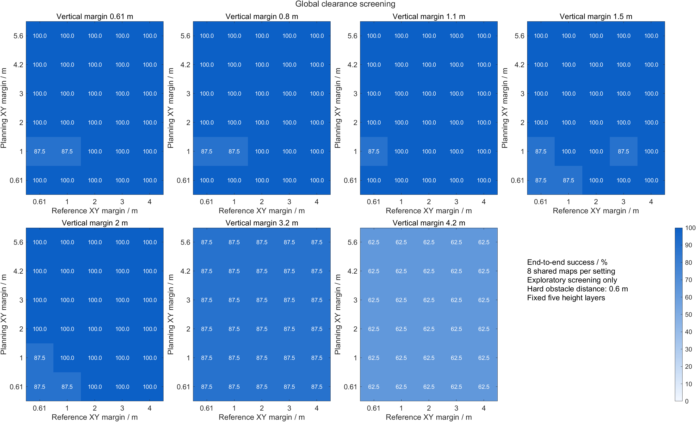

[矢量 PDF](figures/01_global_screen.pdf) · [可编辑 FIG](figures/01_global_screen.fig) · [图表源 CSV](figures/01_global_screen_data.csv)

### 独立验证分场景成功率

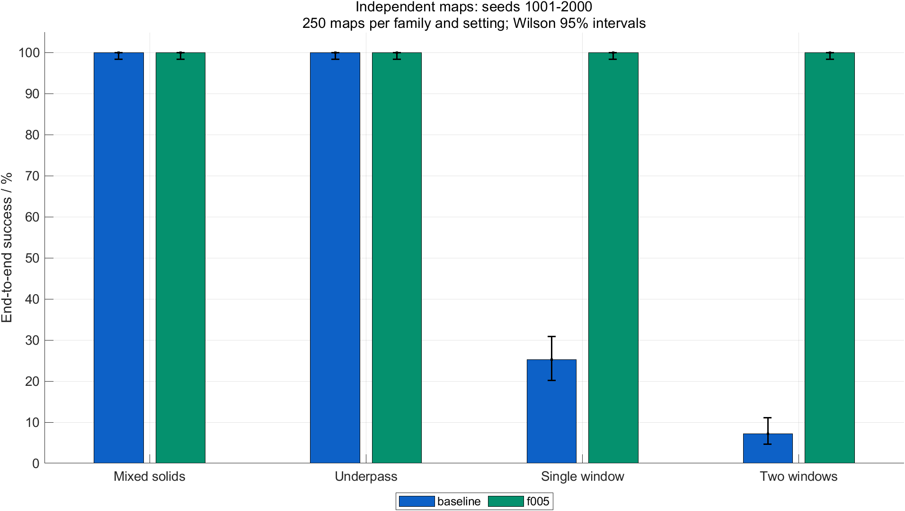

[矢量 PDF](figures/02_holdout_success.pdf) · [可编辑 FIG](figures/02_holdout_success.fig) · [图表源 CSV](figures/02_holdout_success_data.csv)

### 独立验证结局

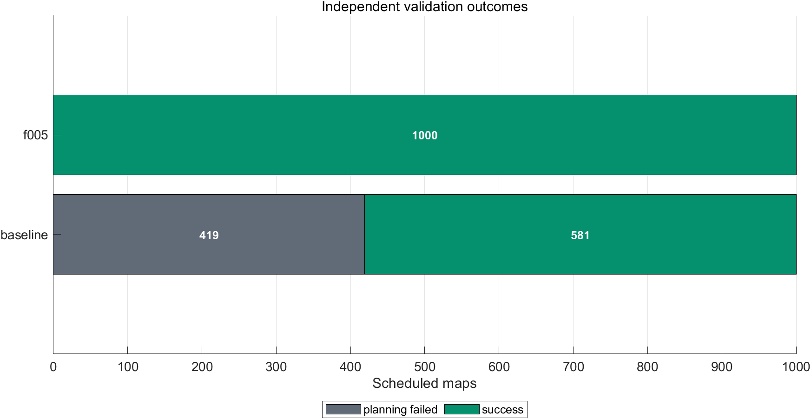

[矢量 PDF](figures/03_holdout_outcomes.pdf) · [可编辑 FIG](figures/03_holdout_outcomes.fig) · [图表源 CSV](figures/03_holdout_outcomes_data.csv)

### 噪声与持续外扰边界

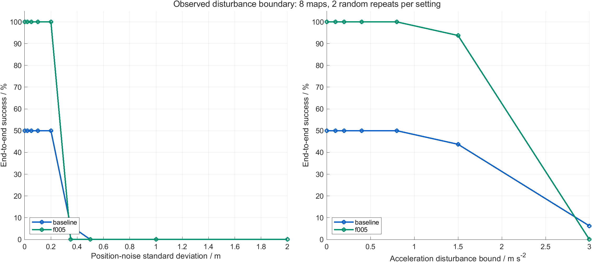

[矢量 PDF](figures/04_disturbance_boundary.pdf) · [可编辑 FIG](figures/04_disturbance_boundary.fig) · [图表源 CSV](figures/04_disturbance_boundary_data.csv)

### 窗口与高度采样边界

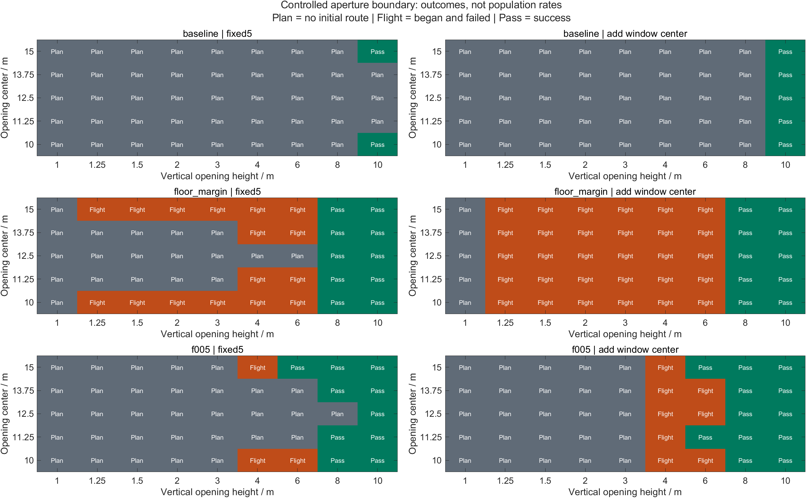

[矢量 PDF](figures/05_aperture_boundary.pdf) · [可编辑 FIG](figures/05_aperture_boundary.fig) · [图表源 CSV](figures/05_aperture_boundary_data.csv)

### 隔离计时

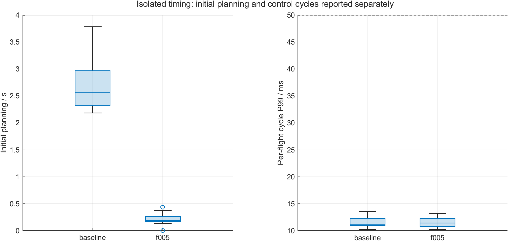

[矢量 PDF](figures/06_isolated_timing.pdf) · [可编辑 FIG](figures/06_isolated_timing.fig) · [图表源 CSV](figures/06_isolated_timing_data.csv)

### 参数消融

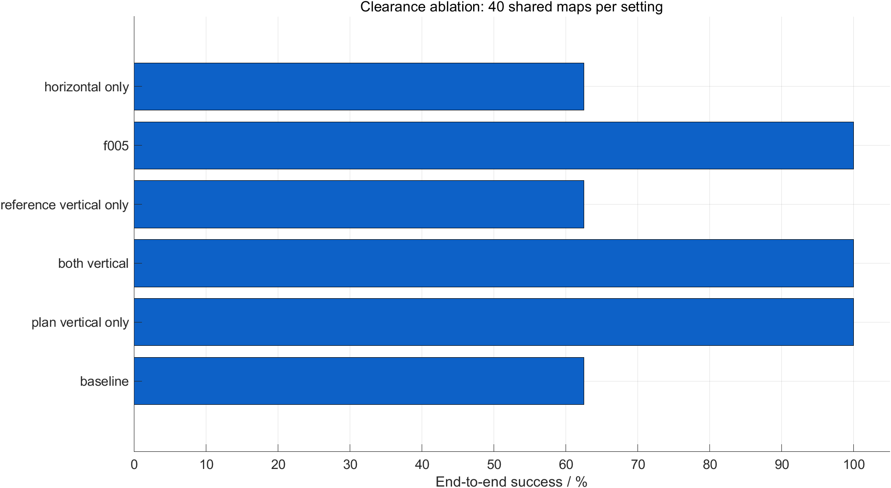

[矢量 PDF](figures/07_clearance_ablation.pdf) · [可编辑 FIG](figures/07_clearance_ablation.fig) · [图表源 CSV](figures/07_clearance_ablation_data.csv)

### 真实高度同步与新增成功队列

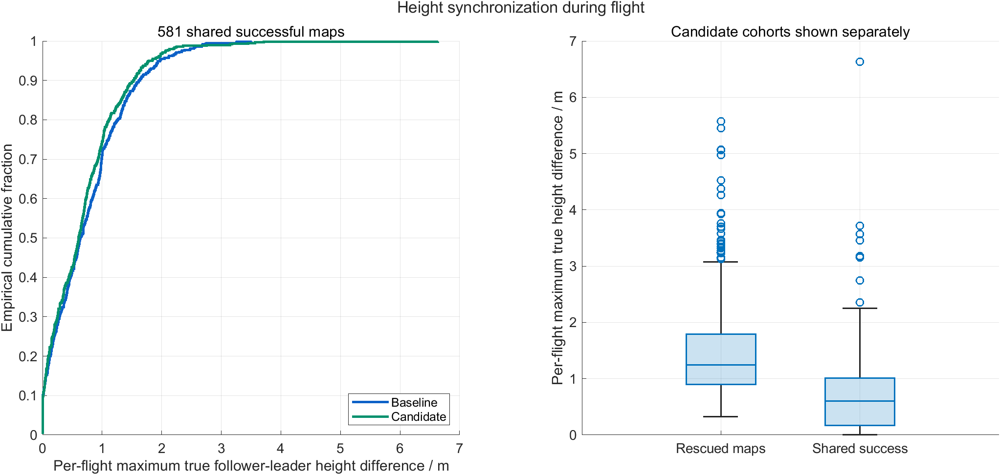

[矢量 PDF](figures/08_height_synchronization.pdf) · [可编辑 FIG](figures/08_height_synchronization.fig) · [图表源 CSV](figures/08_height_synchronization_data.csv)

## 真实轨迹案例

| 案例 | seed | 结局 | 选择规则 |
| --- | --- | --- | --- |
| window | 1011 | success | first seed in family rescued in independent validation |
| staggered_windows | 1004 | success | first seed in family rescued in independent validation |
| boundary_failure | 82 | timeout | first flown candidate failure sorted by noise, disturbance, seed |
| aperture_stagnation | 900031 | timeout | first flown fixed-layer candidate failure in openings at least 6 m, sorted by seed |

### window · seed 1011

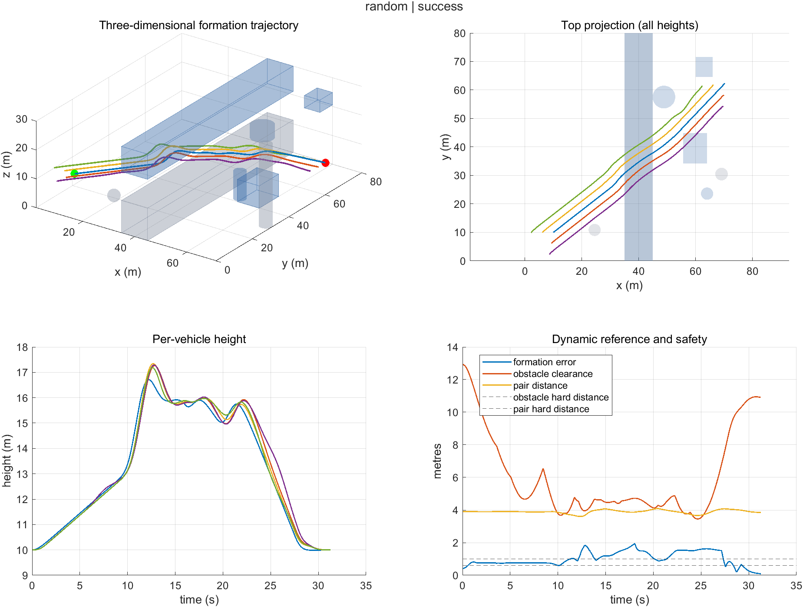

### staggered_windows · seed 1004

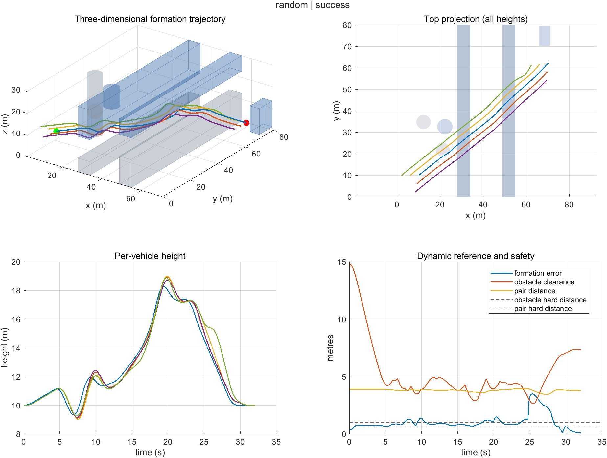

### boundary_failure · seed 82

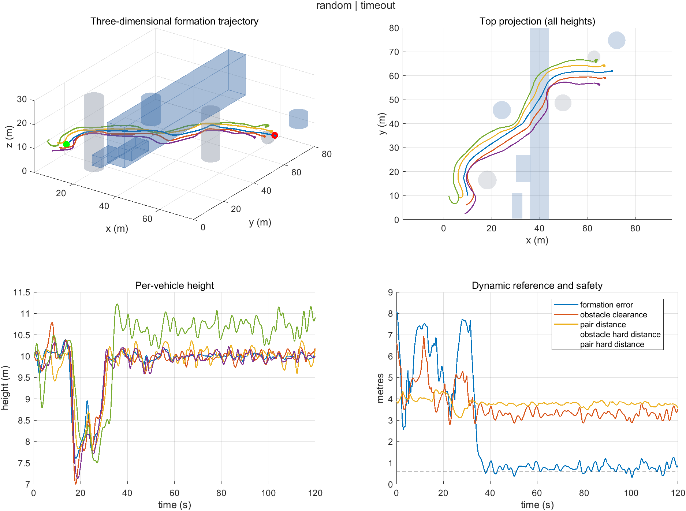

### aperture_stagnation · seed 900031

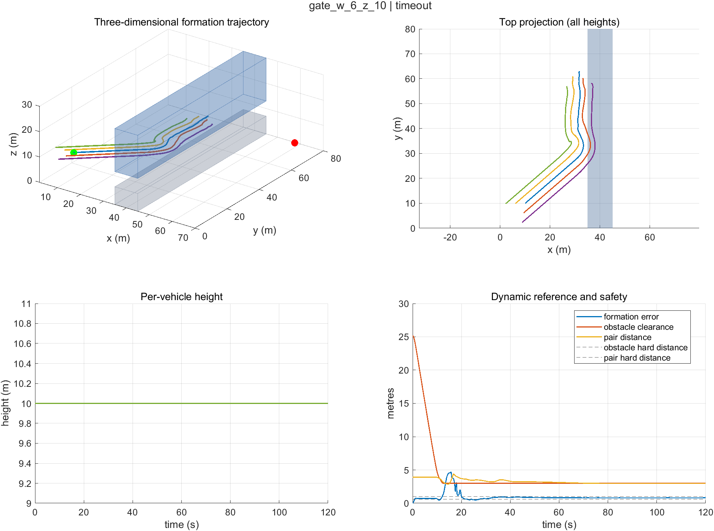

图中的俯视图投影了所有高度的障碍，投影重叠不等于三维碰撞。判断通过窗口或顶棚必须同时看三维轨迹、各机高度和真实物理净空曲线。案例按清单中明确记录的顺序规则取出，用于解释观察到的现象；全样本统计保留所有任务。

## 在 F 盘复现与生成 MP4

在 MATLAB 执行：

```matlab
cd('F:/UAV project/UAV_APF_ADP_Formation');
addpath('config','src','src3d','experiments3d');
[r,folder]=replay_clearance_seed3d(1004,true);
```

该入口读取冻结地图、候选冻结收据和数值源码快照，结果存入项目 F 盘 `results/clearance_replay3d_...` 新目录；成功或失败都保存 MAT，存在飞行日志时输出图表，第二个参数为 true 时输出 `flight_3d.mp4`。seed 1–2000 可按冻结库复现。

`clearance_candidate_params3d()` 返回选定实验预设。直接调用 `main3d(p)` 会根据改变后的 desiredClear 重新生成随机地图，属于新实验；复现本次成功率需要显式使用冻结地图。默认参数仍提供原版兼容模式，本次候选通过具名预设调用。

## 冻结复现与动画验收

通过用户复现入口再次执行 seed 1004，对照原始任务的全部非计时历史字段和终端真实状态，误差均不超过 1e-8；周期墙钟计时不作数值相等要求。MP4 已解码并抽帧检查，分辨率 1920×1080，帧率 12 fps。视频时间标注读取真实仿真日志，播放速度与仿真时间不同。复现额外执行不计入 8422 次实验分母。

[播放示范 MP4](examples/staggered_windows/flight_3d.mp4)

[复现验收记录](replay_validation.json)
