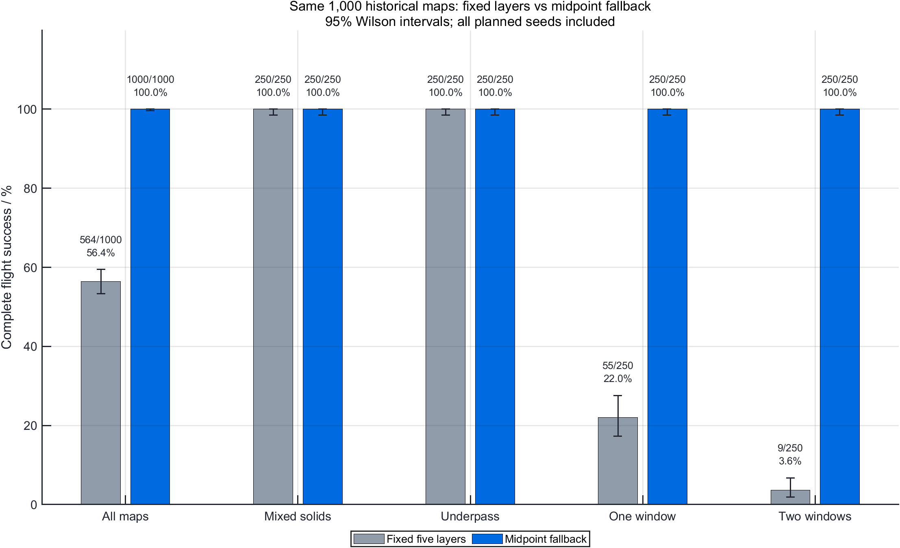
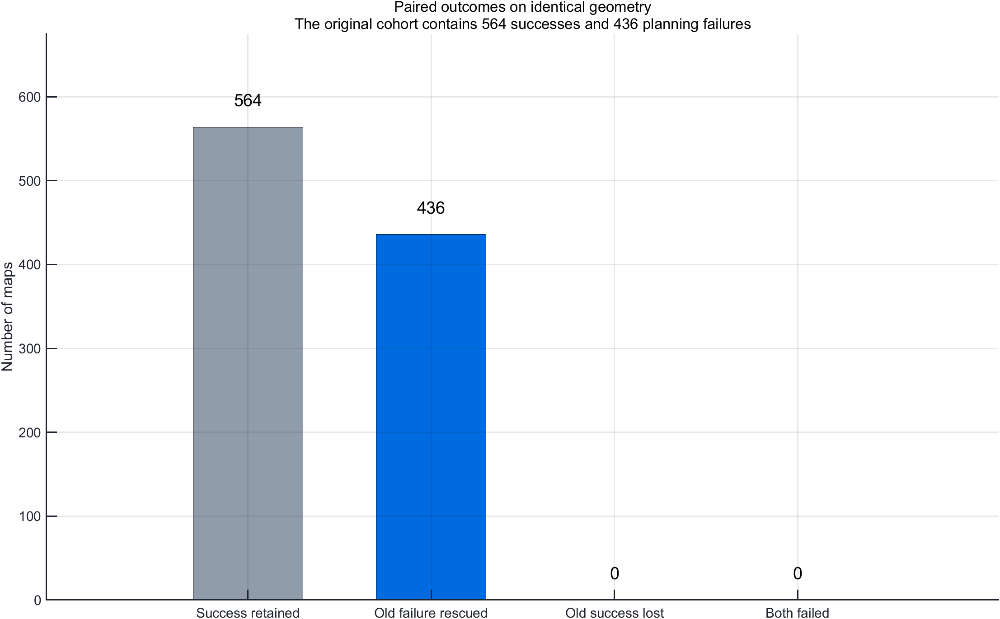
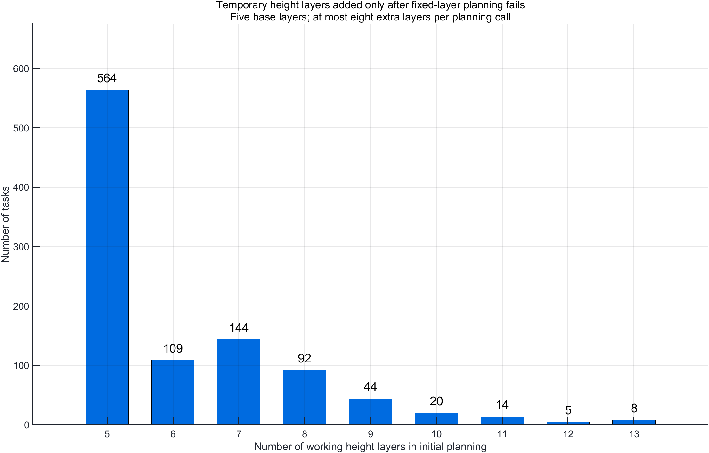
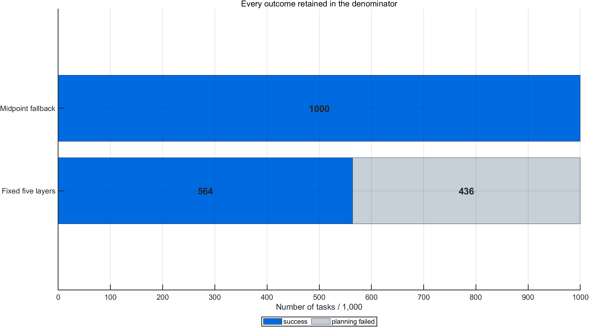

# 临时高度补中点：原 1,000 张地图回放实验

> 完成日期：2026-10-08。使用原保存地图；全部1,000个预定seed纳入分母。

## 主要结果

固定五层 **564/1000（56.4%）**；补中点策略 **1000/1000（100.0%）**，变化 **+43.6个百分点**。
新结果 Wilson 95%区间：99.6173%–100.0000%。该区间针对历史回放样本计算。
原436个失败seed救回 **436/436**；原564个成功seed失去 **0** 个。
初始规划通过 **1000/1000**；完整飞行成功 **1000/1000**，两个指标分别记录。

| 地图族 | 样本数 | 固定五层成功 | 补中点成功 | 新成功率 |
|---|---:|---:|---:|---:|
| 混合三维障碍 | 250 | 250 | 250 | 100.0% |
| 顶棚下穿 | 250 | 250 | 250 | 100.0% |
| 单窗口墙 | 250 | 55 | 250 | 100.0% |
| 交错双窗口墙 | 250 | 9 | 250 | 100.0% |

### 全部结局

| 结局 | 次数 |
|---|---:|---:|
| success | 1000 |

## 实验条件与可比性

- 原地图来自 `seed_sweep3d_v2.1.0_20261005_113155_970`，seed 1–1000；逐图SHA核对。不重新生成、不换seed、不删失败。
- 水平规划/参考余量仍为4.2/4.0 m；传统模式下的竖直规划/参考余量仍为4.2/4.0 m。本轮未叠加上次5.6/4.4/2 m的余量候选。
- 五个基础高度为5/10/15/20/25 m，五架二阶质点；速度/命令加速度上限3 m/s、3 m/s²；障碍硬距离0.6 m、机间硬距离1 m。
- ADP与预测安全层开启；每个seed共享学习权重按原参数重置；位置噪声和外部加速度均为0。
- 成功仍要求目标误差≤1 m、最大参考跟踪误差≤1 m、全机速度≤0.25 m/s，连续满足1 s，且未碰撞、越界或超时。终端成功不代表全程刚性V形。
- 本批是已知历史地图的同图回放，不能称为全新独立地图验证，也不外推到任意三维地图或真实机体。

## 策略与计算预算

先用基础五层规划；无路线时，计算障碍水平投影中心、投影内5×5有限采样、两障碍投影重叠内3×3采样处的竖直可用区间。球、圆柱和长方体按当前余量形成禁行高度区间，合并后取补集。
缺层区间补入中点；已被基础层或先补的临时层覆盖时不重复插入。按投影面积、区间宽度、距起点高度和坐标固定排序。临时层只用于当前地图；输入基础层不改写。所有图边、起终连接与简化航段继续检查三维净空。
路径评分仍为三维路长加1倍累计升降高度，在候选层之间比较整条路线。升降高度是能耗代理指标，当前质点模型没有电池功率模型，不能把该代价直接换算成真实耗电。
默认最多补8层，总层数上限13，1 m水平网格容量上限81×81×13=85,293节点。有限截面和中点采样不构成连续空间完备性证明；局部区间存在也不能代替完整飞行验证。
本批初始补层任务 **436**；初始最大层数 **13**；含重规划/终端规划的最大层数 **13**；触发初始层数预算拒绝的任务 **4**。
已记录最小障碍距离 **1.624738 m**、最小机间距离 **2.213895 m**。
初始规划耗时中位 **3.3132 s**，含固定层尝试和必要的补层重建。四个并发单计算线程MATLAB进程的计时只作成本记录，不作为硬实时证据。

## 本轮耗时记录

初始规划中位 3.3132 s、P95 8.9108 s、最大 14.4522 s。
每条实际飞行的P99控制周期耗时中位 12.3062 ms，最大记录周期 233.0994 ms。共 640935 个正耗时周期，其中 6 个超过 50 ms仿真步长。
采用逐飞行最近秩P99再取中位，不等于合并全部周期的P99；计时包括周期内事件规划。四个MATLAB进程并发，不能据此宣称硬实时。
[逐seed计时CSV](timing_by_seed.csv) · [计时口径](timing_summary.json)

## 首轮覆盖修复与验证

首轮仅取投影中心，会被窗口旁的其他障碍遮住可用截面。首轮中止，保留280条已写CSV和285个MAT文件；中断时尚未完成保存的记录不作正式结果。首轮不并入最终1000图分母。修复增加通用分布截面采样，重新冻结2.3.1并完整重跑。
四组几何/三维测试通过。前16图关闭补层后与旧版非计时历史逐字段完全一致，原试跑补层16/16成功。覆盖修复另检验中心被柱体遮挡的通用窗口以及首轮5个漏解；验证日志保留。初次试跑空高度CSV格式问题已修复，首个日志保留。

原始审核首轮因MATLAB局部区间变量lower遮蔽同名哈希函数而停止。单独修复审核脚本变量名，保留原脚本、错误日志与修复SHA收据；未删除审核条件。最终数值快照与飞行记录使用原冻结文件，修复仅用于读取与核对。
## 科研图表

### 整体与各地图族成功率

[矢量PDF](figures/01_success_by_family.pdf) · [MATLAB FIG](figures/01_success_by_family.fig) · [源CSV](figures/01_success_by_family_data.csv)

### 同图配对结局

[矢量PDF](figures/02_paired_outcomes.pdf) · [MATLAB FIG](figures/02_paired_outcomes.fig) · [源CSV](figures/02_paired_outcomes_data.csv)

### 初始规划工作层数

[矢量PDF](figures/03_initial_layer_counts.pdf) · [MATLAB FIG](figures/03_initial_layer_counts.fig) · [源CSV](figures/03_initial_layer_counts_data.csv)

### 完整任务结局

[矢量PDF](figures/04_outcome_breakdown.pdf) · [MATLAB FIG](figures/04_outcome_breakdown.fig) · [源CSV](figures/04_outcome_breakdown_data.csv)

## 真实飞行示例

按“交错双窗口族中最小救回seed”固定顺序选择 **seed 4**；取自正式原始MAT，不另计一次试验。
临时高度：18.736239 m。
[飞行MP4](examples/seed_000004/flight_3d.mp4) · [区间与决策CSV](examples/seed_000004/height_intervals.csv) · [全机实际高度CSV](examples/seed_000004/actual_heights.csv)

## 原始数据与审核

原始MAT **1000/1000** 审核通过，冻结源码 **36** 个文件哈希匹配。检查参数、原地图与基线文件SHA、CSV/MAT一致性、初始航段净空、补层中点规则、成功末端保持，以及独立顶点物理距离与原连续安全记录。未另行证明所有连续状态的误差界。
[逐seed结果](adaptive_results.csv) · [配对结果](paired_results.csv) · [旧基线](baseline_results.csv) · [失败清单](failures.csv)
[MAT审计](raw_mat_audit.csv) · [地图来源](map_manifest.csv) · [源码哈希](source_sha256.csv)

## Git与复现

数值冻结提交：`e093ba9a90e0053a6d4ca9a9f6adafc1552c2667`，标签 `adaptive-midpoint-run-v2.3.1-20261008`。
回滚基线：`baseline-adaptive-height-v2.2.0-20261008`；实验分支：`experiment/adaptive-midpoint-20261008`。完成标签、Git bundle和数据ZIP在交付目录；未推送远端。
默认 `default_params3d()` 已启用补层；设置 `p.adaptiveHeight.enable=false` 恢复固定层规划。缺少该字段的历史参数默认关闭补层。
复核本批使用冻结原地图和源码。运行 `experiments3d/midpoint_sweep.py run --study <结果目录>` 可恢复检查点；`audit` 审核原MAT，`analyze` 重新统计。直接重新生成地图属于另一批实验。
