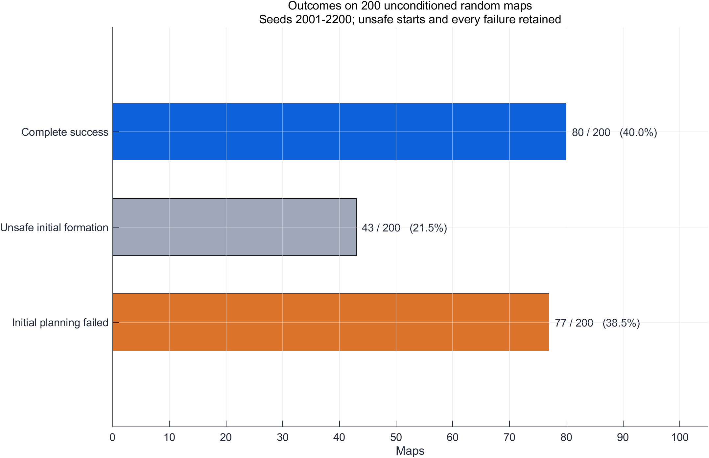
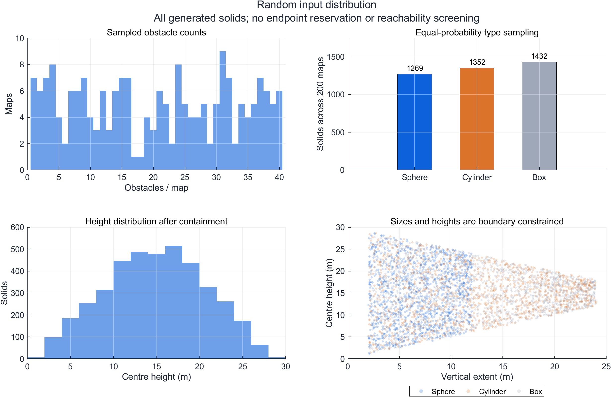
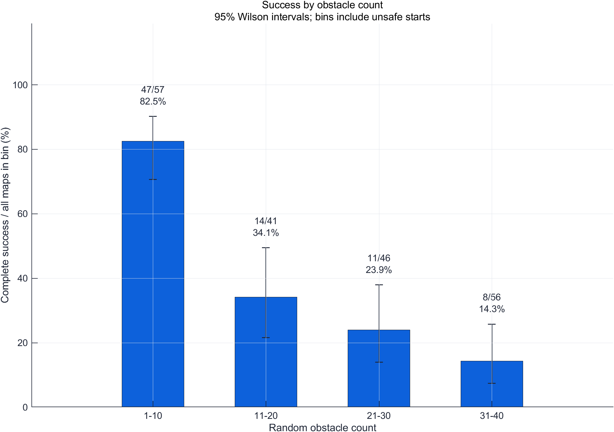
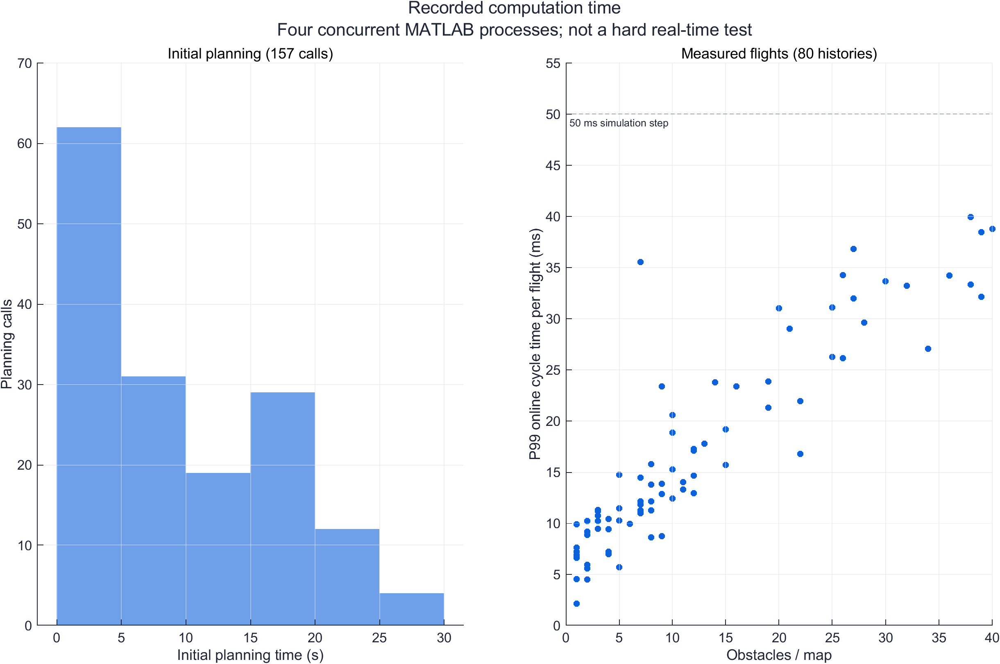
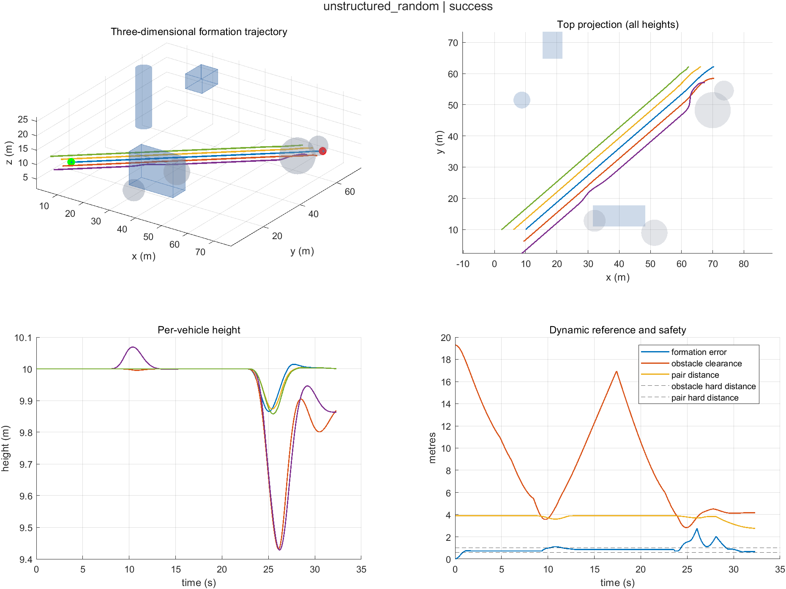
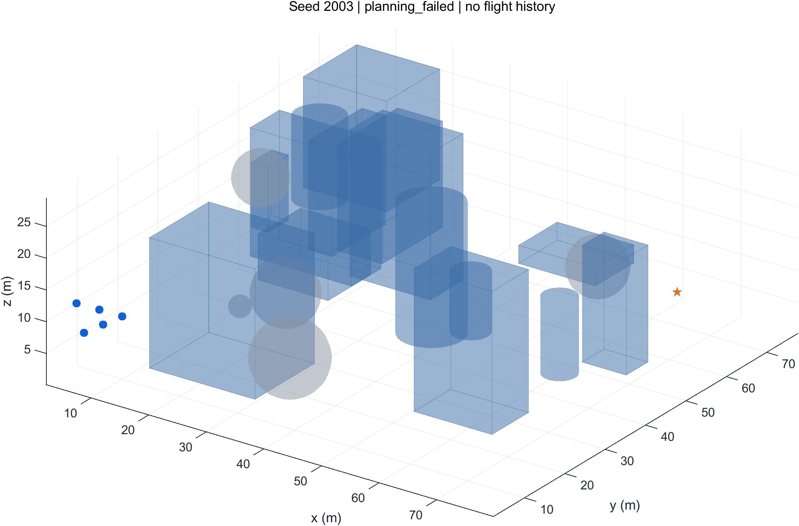

# 无结构随机三维场景

## 80 / 200　·　40.00%

**200 个新 seed：2001–2200。当前 2.3.1 算法。全部随机地图均保留。**

主指标的 Wilson 95% 区间为 **33.46%–46.92%**。它描述本轮规定的随机分布，不能外推任意空域或真实无人机。

## 1. 成功率与分母

| 地图范围 | 成功 / 样本 | 比例 |
| --- | ---: | ---: |
| 全部随机地图 | 80 / 200 | 40.00% |
| 初始五机均满足障碍安全距 | 80 / 157 | 50.96% |
| 初始安全，且长机起终点满足 4.2 m 净空 | 80 / 80 | 100.00% |
| 实际进入飞行阶段 | 80 / 80 | 100.00% |

后面三行是解释性条件结果；主指标始终使用全部 200 张地图。初始编队不安全的地图保留为 `invalid_scene`，不称作飞行中碰撞。执行异常为 0，缺失 seed 为 0。

完整成功要求：长机目标误差≤1 m、最大僚机对动态参考的跟踪误差≤1 m、全机速度≤0.25 m/s，连续保持 1 s，且全程没有安全失败或超时。最大仿真时长 120 s。

## 2. 失败发生在哪一阶段

| 结局 | 数量 |
| --- | ---: |
| 完整成功 | 80 |
| 初始规划失败 | 77 |
| 起飞前编队不安全 | 43 |

在初始规划失败中，**77 张**长机起点或目标点本身不满足 4.2 m 规划净空；**0 张**起终点都满足该净空，但当前有限层规划仍未找到路线。后者可能涉及通道连通性、栅格或补层覆盖限制，不能仅凭本轮记录判为连续空间无解。

补高度层可以补上遗漏的可用高度，不能把被实体占据的起点变成安全起点。起终点净空不足与规划覆盖问题分别记录，避免把不同失败都归因于高度选择。

[逐 seed 失败记录](failures.csv) · [阶段诊断](failure_diagnostics.csv) · [全部结果](all_results.csv)

## 3. 障碍物怎样随机

| 变量 | 预先冻结的采样范围 |
| --- | --- |
| 数量 | 每图整数 1–40，均匀抽样 |
| 类型 | 球、竖直圆柱、轴对齐箱体，逐障碍独立等概率 |
| 球 | 半径 1–6 m，连续均匀 |
| 圆柱 | 半径 1–6 m、高度 2–24 m，连续均匀 |
| 箱体 | 长宽各 2–20 m、高度 2–24 m，连续均匀 |
| 三维位置 | 尺寸确定后，中心在能够容纳该实体的场地区域中均匀抽样 |
| 重叠、起终点、可达性 | 允许重叠；不预留起终点；不筛选可达性；不替换失败地图 |

实际生成 **4053 个实体**：球 1269、圆柱 1352、箱体 1432。实际数量范围 1–40 个，平均 20.265 个／图。

这是有明确边界的随机实验：场地 80×80×30 m，所有实体完整位于场地中。尺寸与可放置中心范围受边界共同约束，因此不声称它们完全独立，也不把本轮范围当作真实空域统计模型。圆柱不再全部从地面长出，球和箱体的高度也随机，没有保证最高层能越过所有障碍的规则。

分组误差线为各组的 Wilson 95% 区间。各组分母包含该组全部地图，包括无法安全起飞的地图；没有在看到结果后挑选地图。名义体积分数按各实体体积相加计算，重叠部分重复计入，不是空间并集占用率。

[200 张地图清单](map_manifest.csv) · [全部障碍的尺寸和坐标](obstacle_catalog.csv)

## 4. 算法与参数

- 沿用 2.3.1：先尝试 5/10/15/20/25 m；固定层失败时补上未覆盖可用区间的中点，最多补 8 层。
- 规划与参考余量维持各向同性 4.2/4.0 m；硬障碍距离 0.6 m、机间距离 1 m。
- 五机质点模型；速度与命令加速度上限 3 m/s、3 m/s²；ADP 和安全层开启，噪声和外扰均为 0。
- 本轮改变随机环境，保持飞行算法和余量。有限采样、栅格和层数预算没有连续空间完备性保证。

本轮初始规划找到路线 **80/200**；77 个任务尝试自适应补层，76 个任务实际补层。初始／全阶段最大工作层数为 13/13。

成功任务中，0 个在初始规划时尝试了补层，0 个实际增加了初始高度层。若为 0，表示这批无结构地图的成功路径由基础五层找到，不能把全部成功归因于补层策略。

上轮 1000 张结构化历史地图回放为 100%，其障碍数量与窗口结构不同。两轮成功率不能用来隔离高度策略的因果收益；同条件比较需要对同一批冻结地图运行不同策略。

## 5. 计算性能

四个单计算线程 MATLAB 进程并发。共 157 次初始规划：中位 6.664 s、P95 22.537 s、最大 29.449 s。

已记录 55616 个正耗时飞行周期。逐飞行 P99 耗时的中位数为 13.834 ms；最大单周期 212.577 ms，其中 11 个周期超过 50 ms 仿真步长。

初始规划时间和在线控制周期分开统计；这些是本机并发时测量值，不是隔离基准或硬实时保证。本轮本地算力可完成，无需租算力。

[逐 seed 耗时](timing_by_seed.csv)

## 6. 看示例与 MP4

### seed 2001 · 最小成功 seed

结局 `success`，障碍 7 个。按预先规则选取，不参与筛选统计。

[播放 MP4](<F:/UAV project/UAV_APF_ADP_Formation/交付文件/无结构随机障碍_200seed_20261008/examples/seed_002001/flight_3d.mp4>)。视频直接由正式 MAT 导出，不重新仿真。
### seed 2003 · 最小初始规划失败 seed

结局 `planning_failed`，障碍 20 个。按预先规则选取，不参与筛选统计。

其余有飞行历史的 seed 可从正式 MAT 导出动画。起飞前失败或规划失败没有飞行轨迹，可查看地图与高度区间决策。

## 7. 证据、复现与回滚

数值源码冻结提交：`abedb59a18fdff0c26ee88c795b5086bfb50c269`。执行标签：`unstructured-random-run-v2.3.1-20261008`；回滚标签：`baseline-unstructured-random-20261008`。

完整原始目录：`F:\UAV project\UAV_APF_ADP_Formation\results\unstructured_random3d_v2.3.1_20261008_172031_791`。所有地图在正式试验前冻结，205 份输入文件和 38 份源码的 SHA-256 校验通过；200 个原始 MAT 与 CSV、原地图逐条核对。独立顶点障碍距离、机间距离、初始几何和成功终端保持检查通过。连续航段净空使用冻结几何函数核对，未另行证明真实机体误差界。

[原始记录审核](raw_mat_audit.csv) · [审核摘要](raw_mat_audit.json) · [冻结协议](protocol.json) · [输入校验值](input_sha256.csv) · [源码校验值](source_sha256.csv)

数据归档和 Git bundle 保存于同一 F 盘交付目录，校验值见交付收据。恢复只读取已有 seed 的检查点，算法与原始记录均可回滚；没有推送远端。
